# M00. Целевая системная архитектура — EndToEndHardened

## 1. Production topology

```mermaid
flowchart TB
  Browser[Browser / React]
  VK[VK]
  PSP[Payment Provider]
  AROMA[AROMA]

  Edge[coffee-edge PUBLIC Nginx]
  Web[platform-web INTERNAL Nginx]
  APIP[api-public]
  APIA[api-agent]
  APII[api-internal]
  RT[realtime-gateway]

  subgraph Channel[Channel Platform]
    CIN[channel-ingress]
    CID[channel-identity-broker]
    CINT[channel-intake]
    CRM[channel-response-mapper]
    COUT[channel-egress]
  end

  subgraph Agent[Agent Platform]
    HD[hermes-dispatcher]
    HR[Hermes Runtime Pool]
  end

  subgraph Catalog[Catalog-owned]
    CatalogSync[catalog-supplier-sync]
    MapResolver[catalog-mapping-resolver]
    SearchIndexer[catalog-search-indexer]
  end

  subgraph Orders[Orders-owned runtime roles]
    Prep[orders-aroma-preparation]
    CatProj[orders-catalog-projection]
    AromaProj[orders-aroma-event-projector]
    Observer[aroma-observer]
    Conv[aroma-convergence]
    Checkout[aroma-checkout-poller]
    OrderInv[orders-invoice-consumer]
    OrderPay[orders-payment-consumer]
  end

  subgraph Invoices[Invoices-owned]
    Inv[invoices-command-handler / invoices-worker]
    InvIntake[invoice-intake]
    InvDoc[invoice-document-worker]
  end

  subgraph Payments[Payments-owned]
    PayOrder[payments-order-consumer]
    PayCmd[payments-command-handler]
    PayHook[payments-webhook]
    PayRec[payments-reconciliation]
  end

  Ops[operations-projections]
  Scan[artifact-scan-worker]
  AromaGW[AROMA Gateway]
  Artifact[(Artifact Storage)]
  PG[(PostgreSQL owner schemas/DBs)]
  Deb[Debezium / Kafka Connect]
  K[(Kafka)]

  Browser --> Edge
  Edge -->|/app| Web
  Edge -->|/api/client-v1| APIP
  Edge -->|/events| RT
  VK -->|/channels/vk/callback| Edge --> CIN
  PSP -->|/webhooks/payments/provider| Edge --> PayHook

  CIN --> CID
  CIN --> K
  K --> CINT --> K
  K --> HD --> HR --> APIA
  HD --> K
  K --> CRM --> K
  K --> COUT --> VK

  APIP --> PG
  APIA --> PG
  APII --> PG

  CatalogSync -->|aroma.catalog.read| AromaGW --> AROMA
  CatalogSync --> PG
  K --> CatalogSync
  K --> MapResolver --> PG
  K --> SearchIndexer --> PG

  K --> Prep --> PG
  K --> CatProj --> PG
  K --> AromaProj --> PG
  Observer -->|aroma.cart.observe| AromaGW
  Conv -->|aroma.cart.mutate| AromaGW
  Checkout -->|aroma.wholesale.read| AromaGW
  Observer --> PG
  Conv --> PG
  Checkout --> PG
  K --> OrderInv --> PG
  K --> OrderPay --> PG

  PG --> Deb --> K

  Checkout --> Artifact
  K --> Inv
  InvIntake --> Artifact
  InvDoc --> Artifact
  InvDoc --> PG
  Inv --> K

  K --> PayOrder
  K --> PayCmd
  PayOrder --> PSP
  PayCmd --> PSP
  PayRec --> PSP
  PayHook --> PG
  PayHook --> K

  Artifact --> Scan --> Artifact
  K --> Ops
  K --> RT
```



Полный executable inventory: `M20_SERVICE_ORCHESTRATION/runtime-workload-registry.yml`. Диаграмма — generated conceptual view; registry не может быть урезан диаграммой.

## 2. End-to-end business path

```text
Draft
 -> trusted confirmation proof / operator confirm
Confirmed + Desired
 -> Catalog mapping/availability
 -> AROMA Desired/Observed/Convergence
 -> InSync
 -> Order-atomic Checkout Freeze
 -> CheckoutAllocationManifest Artifact
 -> WholesaleLinked
 -> Invoice materialization/PDF/price proof
 -> InvoicePriceProofManifest
AwaitingCustomerPayment
 -> PaymentIntent + verified PSP webhook/reconciliation
 -> PaymentSucceeded
Completed
```

AROMA/Checkout/Invoice/Payment — ортогональные state machines и не кодируются дополнительными значениями `Order.Status`.

## 3. Core ownership

| Fact | Owner |
|---|---|
| Customer/addresses/CustomerChannelLink | Customer |
| Raw provider identity attestation | Channel Platform |
| Product/Variant/supplier snapshot/mapping/availability | Catalog |
| Order/Desired/Observed/Convergence/Checkout | Orders |
| Invoice/allocations/PDF/price proof | Invoices |
| PaymentIntent/WebhookInbox/Refund | Payments |
| Provider session/protocol | Gateway/adapter only |
| Binary/large immutable documents | Artifact Storage + owning-context metadata |

## 4. Critical boundaries

- Confirm transaction имеет только Orders DB writes; no Catalog/AROMA/Invoices/Payments HTTP.
- Catalog mapping resolver работает с persisted complete snapshot; только `catalog-supplier-sync` выполняет supplier catalog GET.
- AROMA Gateway method audiences разделяют `catalog.read`, `cart.observe`, `cart.mutate`, `wholesale.read`.
- Invoices не читает Orders DB: CheckoutAllocationManifest самодостаточен.
- Orders не читает Invoices DB: InvoicePriceProofManifest + per-order summary самодостаточны.
- Payment provider callback идёт только в `payments-webhook`; browser redirect не является payment proof.
- Kafka не заменяет ownership/state; delivery at-least-once, effects current-state/idempotency guarded.
