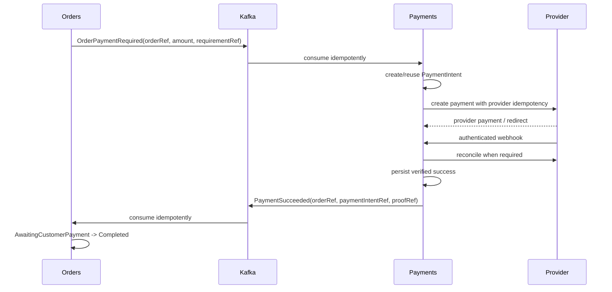

# M08. Payments bounded context

## 1. Ownership

Payments владеет:

```text
PaymentIntent
PaymentAttempt
WebhookInbox
Refund
ProviderReconciliation
```

Orders владеет Order lifecycle. Payments **не обновляет Orders DB**.

## 2. Нормальный customer-payment flow



`OrderPaymentRequired` возникает только после Orders получил durable invoice/price proof и перевёл заказ в `AwaitingCustomerPayment`.

## 3. Payment amount authority

Amount/currency берутся из server-owned Orders payment requirement. Browser/Hermes не задают authoritative сумму.

## 4. Hosted payment

Карточные реквизиты не проходят через CoffeeOrder, Kafka, Hermes, Nginx logs или business PostgreSQL.

## 5. Browser redirect не proof

Final status определяется provider-authenticated webhook/API reconciliation.

## 6. UnknownOutcome

Timeout при create/refund не означает failure. Используются stable provider idempotency key + provider lookup/reconciliation. Blind create на другом provider запрещён.

## 7. Manual collection

Legacy/операторская команда `Деньги собраны` сохраняется только как **явный manual/cash/recovery payment mode**, а не как основной online-payment happy path.

Она требует:

- Order = `AwaitingCustomerPayment`;
- actor;
- reason/payment method;
- expected Order version;
- отсутствие конфликтующего verified/refunding online payment;
- append-only audit.

Результат семантически эквивалентен verified customer payment fact, но источник помечается `manual`.

## 8. Anti-cycle

Payments не делает sync callback в Orders и не запрашивает Order во время webhook transaction. Всё необходимое для intent создаётся из durable `OrderPaymentRequired` payload/local state. Verified facts возвращаются через Kafka.

## 9. Security boundary

Payments получает отдельные DB credentials, provider secrets, Kafka ACL, service identity и audit/SLO.

## 10. PaymentIntentReady / browser handoff

После durable создания/reuse intent Payments публикует `PaymentIntentReady` без provider redirect URL/secrets. Orders может обновить payment summary и realtime invalidation.

Когда пользователь нажимает `Оплатить`, browser обращается к Payments-owned `client-v1` endpoint по `paymentIntentRef`; Payments возвращает/redirect'ит на актуальный hosted provider checkout. Order Card не хранит provider URL как authoritative долговечный факт.

## 11. Cancellation race

`OrderCancelled` может потребляться Payments для отмены ещё не завершённого intent. Если verified `PaymentSucceeded` приходит после Order уже Cancelled, Orders **не воскресает заказ**: создаётся payment reconciliation/refund incident. Generic cancellation из `AwaitingCustomerPayment` поэтому запрещена и заменяется explicit coordinated workflow.

## 12. Explicit refund contracts

Refund/cancel provider operations live on `coffee.payments.commands.v1`; verified outcomes return on `coffee.payments.lifecycle.v1`. See `03_REFUND_CANCELLATION_AND_COMPENSATION.md`.
