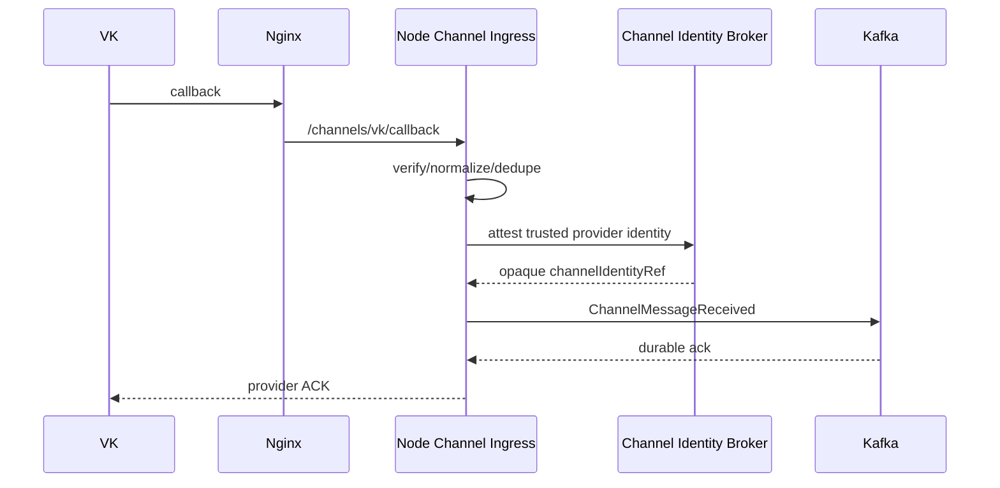

# 12. VK → Kafka → Hermes → CoffeeOrder → VK

## 1. Inbound



Node не ждёт Hermes/model completion перед callback ACK.

## 2. Turn intake

```text
channels.inbound
 -> intake/dedupe/turnSequence
 -> agent.turn.requested
```

## 3. Dispatcher

TypeScript Hermes Dispatcher:

- один active turn на conversation;
- разные conversations параллельно;
- sticky Hermes shard;
- durable `AgentTurn` journal;
- `/v1/runs` submission;
- capacity/backpressure handling;
- completion mapping.

## 4. Agent

Пример:

```text
User: "Мне как обычно две Сафари"

Hermes:
resolve_current_customer()
get_recent_order_pattern()
search_products(...)
get_current_order()
add_order_item(...)
get_order_summary()
```

## 5. Outbound

```text
AgentTurnCompleted **или terminal AgentTurnFailed**
 -> channel-response-mapper
 -> Kafka channels.outbound
 -> Node Channel Egress
 -> VK API
```

Node Egress владеет provider transport state/rate limiting, но не Order state.

## 6. High throughput

Capacity scale units:

```text
messages/sec
active turns
turn duration
model tokens/sec
tools/turn
provider quotas
Kafka lag/oldest age
```

10k concurrent conversation identities — test floor, не architectural limit.


## Node runtime requirement

TypeScript Channel Ingress/Egress и Hermes Dispatcher следуют M04 Node.js Runtime Contract и M06 Node.js Kafka Runtime: one process per role, bounded pools/concurrency, AbortSignal deadlines, ELU/RSS metrics и graceful Kafka/HTTP drain.


## Terminal failure reply

`channel-response-mapper` consumes both completed and failed turn topics. `AgentTurnFailed.userSafeFallbackText` is the only text allowed for automatic failure reply; raw exception/provider detail never reaches VK.
