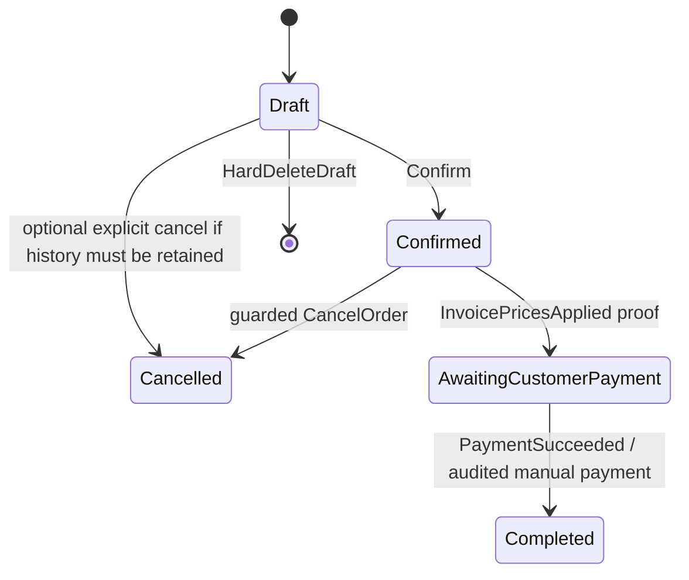

# M12. Order Lifecycle State Machine

## 1. States

```text
Draft
Confirmed
AwaitingCustomerPayment
Completed
Cancelled
```

## 2. Semantic meaning

| State | Значение |
|---|---|
| Draft | mutable customer intent, supplier intent ещё не committed |
| Confirmed | customer/business intent committed; supplier synchronization может быть ещё не завершена |
| AwaitingCustomerPayment | immutable invoice/price proof готов, требуется customer payment |
| Completed | customer payment verified либо явно audited manual collection |
| Cancelled | бизнес-заказ отменён; supplier consequences reconciled/compensated согласно gates |

## 3. Allowed transitions



`Confirmed -> Draft` запрещён. Исправление confirmed order выполняется explicit commands.

## 4. Confirmation

Requirements:

- exact current OrderVersion;
- non-empty items;
- valid markup/provenance;
- actor/origin;
- profile not blocked/checkout pending;
- AI/VK confirmation proof/idempotency when applicable.

Success означает только committed business intent + local durable preparation. Не означает `InAromaCart`.

## 5. Cancellation

`CancelOrder` не является generic status patch. Он должен в одной Orders transaction:

- validate version/state;
- enforce checkout/invoice/payment irreversible gates;
- update status/history;
- remove/exclude Desired sources through revision service;
- archive active supplier projection as required;
- stage Outbox events;
- commit.

Physical cart cleanup выполняет convergence после commit.

## 6. AwaitingCustomerPayment

Переход допускается только после durable exact invoice/price proof для всех relevant items. Наличие произвольной `ActualPurchaseUnitPrice` без proof недостаточно.

## 7. Completed

`Completed` **не означает** supplier fulfillment. Это customer-payment terminal state.

## 8. State-independent diagnostics

AROMA sync status, fulfillment status и checkout status отображаются рядом, но не меняют название lifecycle state.

## 9. Naming discipline

В TypeScript типы должны быть квалифицированы, чтобы три `Completed` не смешивались:

```text
OrderLifecycleStatus.Completed
SupplierFulfillmentStatus.Completed
AromaCheckoutStatus.Completed
```

Legacy `OrderItemFulfillmentStatus` может быть перенесён семантически, но target name `SupplierFulfillmentStatus` предпочтителен для устранения неоднозначности.

## 10. AI/VK proof rule

Normal AI/VK flow keeps Order as Draft while a `OrderConfirmationChallenge` is pending. `Draft -> Confirmed` occurs only after structured trusted channel proof or explicit operator approval. The LLM cannot synthesize this proof. See M09 `07_AI_VK_CONFIRMATION_AND_APPROVAL_PROOF.md`.
