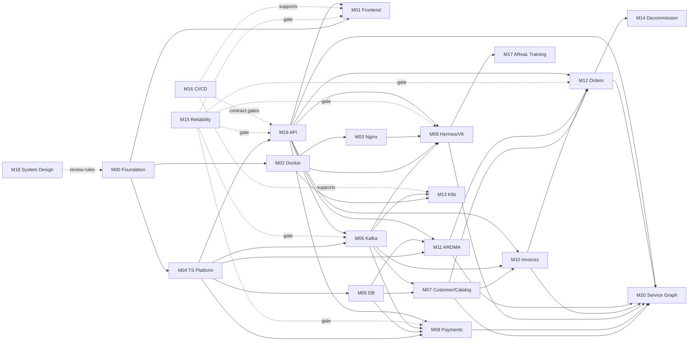

# Индекс программ новой архитектуры CoffeeOrderSystem

Документация сгруппирована по **программам реализации**, а не по типу технологии. Ревизия EndToEndHardened закрывает execution contracts сквозной цепочки Orders/AROMA/Invoices/Payments/VK/Hermes и сохраняет CatalogHardened business logic.

## Карта программ

| Программа | Назначение | Основной результат |
|---|---|---|
| M00 Architecture Foundation | Канон архитектуры, clean-room, target ownership | единый source of truth |
| M01 Frontend Handover | Перенос существующего React | `platform/apps/web` canonical |
| M02 Docker / Compose | Исполняемая local/reference topology | immutable images + compose profiles |
| M03 Nginx Strangler | Пошаговый route cutover | legacy/target switch без big bang |
| M04 TypeScript Platform | Общая online platform foundation | strict TS/API/contracts/security |
| M05 Database Migration | DB0→DB5 и single-writer ownership | безопасный schema cutover |
| M06 Kafka / Event Platform | Durable event backbone | KRaft + Topic Registry + Outbox/CDC + schemas + replay/DR |
| M07 Customer / Catalog / Products | Product lifecycle, supplier snapshot, mapping/availability/pricing | proven Catalog truth + Orders/AROMA reaction |
| M08 Payments | Новый target-native bounded context | provider-safe payment lifecycle |
| M09 Hermes / VK | AI seller runtime и high-throughput channels | EDA-080…084 |
| M10 Invoices | Invoice/materialization/reconciliation | TypeScript invoice ownership |
| M11 AROMA Gateway | Provider boundary и migration safety | transport + state-machine parity |
| M12 Orders | Финальный consistency-core rewrite | TypeScript Orders authority |
| M13 Kubernetes / Microservices | Production orchestration/scale | selective services + K8s |
| M14 Decommission | Удаление legacy | C# production workloads = 0 |
| M15 Reliability / Operations | SLO, backpressure, DR, testing | operational release gates |
| M16 CI/CD / Supply Chain | Воспроизводимые artifacts/deploys | immutable provenance |
| M17 AReaL Training-only | Будущее обучение собственной модели | dataset→train→shadow→canary |
| M18 System Design Selections | Ограничители архитектурной сложности | accepted/deferred patterns |
| M19 API Architecture | Actor/trust/transport contract architecture | client/agent/internal/webhook/provider/event/realtime APIs |
| M20 Service Orchestration | Cross-context sync/async dependency policy | cycle-free ownership/service graph |

## Логическая последовательность

## Как пользоваться

1. Начинать с `M00_ARCHITECTURE_FOUNDATION/README.md`.
2. Для конкретной workstream открыть `README.md` программы.
3. Использовать `IMPLEMENTATION_BACKLOG_BY_PROGRAMS.md` для issue/task decomposition.
4. Перед production cutover проверять M15 release gates.
5. `MASTER_ARCHITECTURE.md` нужен для полнотекстового чтения/поиска; source of truth — отдельные program documents.

## Agent skill mapping

| Программа | Skill |
|---|---|
| M00 | `next-architecture-foundation` |
| M01 | `next-react-handover` |
| M02 | `next-docker-compose-runtime` |
| M03 | `next-nginx-strangler` |
| M04 | `next-typescript-platform` |
| M05 | `next-postgres-migration` |
| M06 | `next-kafka-event-platform` |
| M07 | `next-customer-catalog-migration`, `next-catalog-product-lifecycle` |
| M08 | `next-payments-platform` |
| M09 | `next-hermes-vk-runtime` |
| M10 | `next-invoices-migration` |
| M11 | `next-aroma-migration` |
| M12 | `next-orders-migration` |
| M13 | `next-kubernetes-microservices` |
| M14 | `next-legacy-decommission` |
| M15 | `next-reliability-operations` |
| M16 | `next-cicd-supply-chain` |
| M17 | `next-areal-training` |
| M18 | `next-system-design-governance` |
| M19 | `next-api-architecture` |
| M20 | `next-business-orchestration` |

Для всех значимых target-задач первым активируется `next-architecture-router`. Для migration/cutover также активируется `next-verification-and-parity`.

## Сквозной Node.js Runtime Contract

`next-nodejs-runtime` — cross-cutting skill/contract для M04/M06/M09/M13/M15/M16/M19. Нормативные документы:

- `M04_TYPESCRIPT_PLATFORM/06_NODEJS_RUNTIME_ARCHITECTURE.md`;
- `M06_KAFKA_EVENT_PLATFORM/04_NODEJS_KAFKA_RUNTIME.md`;
- `M15_RELIABILITY_OPERATIONS/07_NODEJS_RUNTIME_SLO_AND_CAPACITY.md`;
- `M16_CICD_SUPPLY_CHAIN/02_NODEJS_CONTAINER_CICD_BASELINE.md`;
- `M19_API_ARCHITECTURE/10_NODEJS_HTTP_RUNTIME_CONTRACT.md`.

Любая production Node задача активирует `next-nodejs-runtime` вместе с owning program skill.

## Сквозной Kafka Platform Contract

M06 теперь является не только application event design, но и production platform contract. Его hardening пересекает:

- M04 — Node Kafka runtime;
- M13 — KEDA не меняет partitions;
- M15 — broker/consumer/Debezium SLO и DR;
- M16 — topic/schema/IaC/drift gates;
- M19 — asynchronous API governance.

Canonical topics: `M06_KAFKA_EVENT_PLATFORM/kafka-topic-registry.yml`.

Canonical executable topology: `M20_SERVICE_ORCHESTRATION/runtime-workload-registry.yml`.
