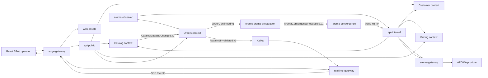

# Границы и runtime

## Как читать атлас

Этот документ разделяет четыре разных утверждения:

- **[SPEC]** — нормативная архитектура или delivery-спецификация; это намерение и контракт, а не доказательство текущего поведения.
- **[IMPLEMENTED-IN-CODE]** — в snapshot `4b2cad1dab30af66ad0b2fe64da280222e506574` найдена предметная реализация в `apps/` или `packages/`.
- **[STUB/PLANNED]** — присутствует runtime entrypoint, конфигурация или контейнер, но предметный обработчик/worker в исходниках не материализован.
- **[UNKNOWN]** — из чтения репозитория нельзя заключить о runtime acceptance, production readiness, полном dataset, HA, restart durability или внешнем провайдерском результате.

Важное ограничение: наличие запускаемых runtime не означает готовность business/durable paths. Именно это предупреждение закреплено в authority package; ADR-0025 отдельно говорит, что Fastify foundation #3 — исполнимый каркас, а не завершённый production runtime. [SPEC] ([AGENTS.md:L1-L5], [docs/adr/ADR-0025-fastify-launch-recovery.md:L49-L54])

## Архитектурная рамка: bounded context не равен процессу

Система проектируется сразу как микросервисы, без промежуточного модульного монолита. Основной стек — строгий TypeScript, Node.js 26 Current, Fastify-first, существующий PostgreSQL 17, Kafka как асинхронный транспорт, HTTP для синхронных запросов, SSE для invalidation/progress и Docker Compose как первое воспроизводимое окружение. [SPEC] ([docs/launch/00_SCOPE_AND_DECISIONS.md:L3-L19])

При этом bounded context, runtime process и deployment unit различаются. Один контекст может быть разложен на несколько процессов с разными trust boundary, I/O и failure profile; особенно это видно в Catalog и Orders. В runtime catalog Catalog разделён на `catalog-service`, `catalog-supplier-sync` и `catalog-activation-worker`, а Orders — на `orders-service`, `orders-aroma-preparation`, `aroma-observer` и `aroma-convergence`. [SPEC] ([config/service-catalog.json:L62-L89], [config/service-catalog.json:L102-L143])

Источник истины принадлежит bounded context, а не gateway или Kafka. PostgreSQL является источником состояния, Kafka — долговечным перемещением; delivery at-least-once компенсируется Inbox, idempotency и state guards. Межвладельческий SQL запрещён. [SPEC] ([docs/launch/00_SCOPE_AND_DECISIONS.md:L11-L17], [docs/launch/05_DATA_OWNERSHIP.md:L18-L23], [docs/launch/06_EVENTS_AND_RECOVERY.md:L46-L53])

## Bounded contexts и владельцы

| Контекст | Владелец и истина | Граница ответственности | Runtime-материализация в snapshot |
|---|---|---|---|
| **Platform ingress/API** | `platform`; бизнес-состояние не владеет | Публичный TLS/auth/routing ingress; stateless client-v1 и internal-v1 composition roots; не принимает бизнес-решения | [SPEC] `edge-gateway`, `api-public`, `api-internal`; у `api-public` и `api-internal` есть рабочие composition roots, но набор downstream business endpoints неполон [IMPLEMENTED-IN-CODE] ([config/service-catalog.json:L12-L41], [apps/api-public/src/main.ts:L1-L20], [apps/api-internal/src/main.ts:L1-L22]) |
| **Frontend** | `frontend`; server state остаётся на owner API | Immutable React SPA assets, browser fetch client, TanStack Query и SSE invalidation | [SPEC] `web`; исходный `apps/web/src/main.ts` только вызывает общий runtime bootstrap, UI materialization не наблюдается [STUB/PLANNED] ([docs/launch/README.md:L76-L82], [apps/web/src/main.ts:L1-L3]) |
| **Customer** | `customer-service`, БД `coffee_platform_customer` | Customer identity, contacts, addresses, channel links; public create/search и internal order-input | [IMPLEMENTED-IN-CODE] предметная реализация Customer и PostgreSQL repository присутствует; это не означает acceptance [SPEC/IMPLEMENTED-IN-CODE] ([config/service-catalog.json:L52-L60], [docs/launch/05_DATA_OWNERSHIP.md:L10-L15], [apps/customer-service/src/main.ts:L53-L82]) |
| **Catalog** | Catalog owner; БД `coffee_platform_catalog` | Products, variants, supplier snapshots, aliases/mapping, availability; supplier full-read, Received generation и атомарная activation | [SPEC] три runtime заявлены; все три `src/main.ts` — только `startConfiguredRuntime(...)`, предметного Catalog кода в `apps/` не найдено [STUB/PLANNED] ([config/service-catalog.json:L62-L89], [apps/catalog-service/src/main.ts:L1-L3], [apps/catalog-supplier-sync/src/main.ts:L1-L3], [apps/catalog-activation-worker/src/main.ts:L1-L3]) |
| **Pricing** | `pricing-service`, БД `coffee_platform_pricing` | Policy version, immutable time-bounded PricingQuote, canonical hash, verification | [SPEC] runtime и HTTP surface описаны; `src/main.ts` содержит только bootstrap, реализация расчёта в app не наблюдается [STUB/PLANNED] ([config/service-catalog.json:L92-L100], [docs/launch/16_PRICING_IMPLEMENTATION_SPEC.md:L1-L20], [apps/pricing-service/src/main.ts:L1-L3]) |
| **Orders** | `orders-service` и специализированные Orders workers; БД `coffee_platform_orders` | Draft/Order/Confirm, immutable agreement snapshots, history, Desired/Observed/Convergence/Attempt/Lease/Fence, checkout proof и Order Card | [SPEC] четыре runtime и owner-local DB roles; в исходниках три workflow runtime имеют только bootstrap, поэтому durable Orders path не доказан [STUB/PLANNED] ([config/service-catalog.json:L102-L143], [docs/launch/05_DATA_OWNERSHIP.md:L15-L24], [apps/orders-service/src/main.ts:L1-L3], [apps/orders-aroma-preparation/src/main.ts:L1-L3], [apps/aroma-observer/src/main.ts:L1-L3], [apps/aroma-convergence/src/main.ts:L1-L3]) |
| **Integration / AROMA** | `aroma-gateway`, БД `coffee_platform_integration` | Provider session/protocol, typed catalog/cart primitives, provider operation journal; не владеет Order или Catalog truth | [IMPLEMENTED-IN-CODE] полноценный gateway composition, provider session, cart reader, mutation journal и HTTP routes присутствуют. Acceptance внешнего AROMA не заявляется [IMPLEMENTED-IN-CODE/UNKNOWN] ([config/service-catalog.json:L146-L153], [apps/aroma-gateway/src/main.ts:L47-L162]) |
| **Realtime** | `realtime-gateway`; бизнес-состояния нет | Kafka invalidation → bounded SSE fanout; один instance в launch-профиле | [SPEC] runtime catalog/config есть; `src/main.ts` только bootstrap, SSE consumer/fanout не наблюдается [STUB/PLANNED] ([config/service-catalog.json:L156-L162], [docs/launch/06_EVENTS_AND_RECOVERY.md:L38-L44], [apps/realtime-gateway/src/main.ts:L1-L3]) |

Итого: 15 launch runtime. Число является нормативно закреплённым в `service-catalog.json` (`exactRuntimeCount: 15`) и соответствует перечислению 15 записей; `config-bootstrap` — init role, а `api-agent` — planned и не входят в первый запуск. [SPEC] ([config/service-catalog.json:L9-L10], [docs/launch/00_SCOPE_AND_DECISIONS.md:L21-L38])

## Каталог 15 runtime по роли

1. **edge-gateway** — единственный public TLS/auth/routing ingress. Он маршрутизирует `web`, `api-public` и `realtime-gateway`; бизнес-оркестрации в нём нет. [SPEC] ([config/service-catalog.json:L12-L21])
2. **api-public** — private trust root для `/api/client-v1`; делегирует Customer, Catalog, Pricing и Orders. Фактический composition root сейчас создаёт только HTTP client к Customer и регистрирует public routes через adapter factory. [SPEC/IMPLEMENTED-IN-CODE] ([config/service-catalog.json:L24-L31], [apps/api-public/src/main.ts:L1-L20])
3. **api-internal** — mTLS/delegation root для `/api/internal-v1`; по каталогу должен ходить к Customer, Catalog, Pricing и AROMA Gateway. Код main создаёт Customer и AROMA Gateway clients, поэтому materialized coverage уже не совпадает с полным catalog surface. [SPEC/IMPLEMENTED-IN-CODE] ([config/service-catalog.json:L34-L41], [apps/api-internal/src/main.ts:L1-L22])
4. **web** — раздача SPA assets. Наблюдается только runtime entrypoint; browser build/UI acceptance неизвестны. [SPEC/STUB/PLANNED] ([config/service-catalog.json:L44-L49], [apps/web/src/main.ts:L1-L3])
5. **customer-service** — единственный из core business runtimes, кроме AROMA Gateway, где найден предметный app-код. Main проверяет database/context, загружает delegation/cursor keys, создаёт signer/verifiers и регистрирует customer routes; application layer валидирует actor/scope/idempotency/correlation и нормализует create input. [IMPLEMENTED-IN-CODE] ([apps/customer-service/src/main.ts:L53-L82], [apps/customer-service/src/http/index.ts:L21-L40], [apps/customer-service/src/application/create-customer.ts:L21-L40])
6–8. **catalog-service**, **catalog-supplier-sync**, **catalog-activation-worker** — логически один Catalog context, но разные DB access roles и failure profiles: read API, supplier import в Received generation, затем activation/outbox. В app source каждого наблюдается только трёхстрочный bootstrap. [SPEC/STUB/PLANNED] ([config/service-catalog.json:L62-L89], [apps/catalog-service/src/main.ts:L1-L3], [apps/catalog-supplier-sync/src/main.ts:L1-L3], [apps/catalog-activation-worker/src/main.ts:L1-L3])
9. **pricing-service** — owner quote/policy/hash; его public/internal contracts нормативно описаны, но code materialization отсутствует за пределами bootstrap. [SPEC/STUB/PLANNED] ([config/service-catalog.json:L92-L100], [apps/pricing-service/src/main.ts:L1-L3])
10. **orders-service** — core Order writer: Draft, item commands, Confirm, history, Outbox и Order Card по спецификации. В snapshot найден только bootstrap. [SPEC/STUB/PLANNED] ([config/service-catalog.json:L102-L111], [apps/orders-service/src/main.ts:L1-L3])
11. **orders-aroma-preparation** — single writer Desired и per-Order AROMA projection, consuming `OrderConfirmed`, mapping and AROMA facts. Только bootstrap. [SPEC/STUB/PLANNED] ([config/service-catalog.json:L114-L122], [apps/orders-aroma-preparation/src/main.ts:L1-L3])
12. **aroma-observer** — durable scheduled read физической корзины и owner fact `AromaObservationChanged`. Только bootstrap. [SPEC/STUB/PLANNED] ([config/service-catalog.json:L125-L132], [apps/aroma-observer/src/main.ts:L1-L3])
13. **aroma-convergence** — lease/fence/reservation state machine GET→at most one unsafe mutation→GET. Только bootstrap. [SPEC/STUB/PLANNED] ([config/service-catalog.json:L135-L143], [apps/aroma-convergence/src/main.ts:L1-L3])
14. **aroma-gateway** — единственный observed предметный provider adapter. Composition создаёт `ProviderHttpClient`, `ProviderSessionManager`, `OfferBindingStore`, `ProviderCartReader`, journal store, `ProviderCartMutator`, executor и четыре HTTP route families; recovery journal вызывается при старте. [IMPLEMENTED-IN-CODE] ([apps/aroma-gateway/src/main.ts:L47-L152])
15. **realtime-gateway** — fanout invalidation без business state; launch допускает один instance, а общий Kafka consumer group не доставляет событие всем SSE connections при горизонтальном масштабировании. [SPEC/STUB/PLANNED] ([config/service-catalog.json:L156-L162], [docs/launch/06_EVENTS_AND_RECOVERY.md:L38-L44])

## Компонентная схема

Схема показывает [SPEC] topology, а не observed end-to-end execution. Browser не вызывает владельцев напрямую: команды идут через `edge-gateway` и `api-public`; Kafka-инвалидация идёт через `realtime-gateway`, затем Edge и SSE. Нормативная boundary запрещает `Confirm` вызывать Catalog, Pricing или AROMA по HTTP; Confirm сохраняет Order/contribution/history/Outbox локально, после commit подготовка строит cart-level Desired. [SPEC] ([docs/launch/01_RUNTIME_ARCHITECTURE.md:L33-L45], [docs/launch/05_DATA_OWNERSHIP.md:L26-L42], [docs/CoffeeOrderSystem_CANONICAL_Architecture_EndToEndHardened_RU_2026-08-19/M04_TYPESCRIPT_PLATFORM/03_NODEJS_TYPESCRIPT_EVENT_PLATFORM.md:L52-L62])

## Фактическая materialization и главные расхождения

- [IMPLEMENTED-IN-CODE] Общий `platform-runtime` действительно содержит healthcheck TLS/mTLS и runtime identity checks; это infrastructure foundation, не business acceptance. [packages/platform-runtime/src/index.ts:L59-L115]
- [IMPLEMENTED-IN-CODE] Customer имеет substantive source: route registration, input normalization, idempotency command validation, delegation verification и PostgreSQL repository. [apps/customer-service/src/main.ts:L53-L82], [apps/customer-service/src/http/index.ts:L21-L40]
- [IMPLEMENTED-IN-CODE] AROMA Gateway имеет substantive source: provider origin policy, bounded response size, encrypted session setup, catalog export boundary, cart reader, mutation executor and restart recovery. [apps/aroma-gateway/src/main.ts:L32-L45], [apps/aroma-gateway/src/main.ts:L59-L113], [apps/aroma-gateway/src/main.ts:L122-L152]
- [STUB/PLANNED] Остальные core business apps в `src/` представлены только вызовом `startConfiguredRuntime`. Наличие `dist/main.js` и Compose service не считается materialized business behavior: это производный build output/runtime packaging, а не найденный owner handler. [apps/catalog-service/src/main.ts:L1-L3], [apps/pricing-service/src/main.ts:L1-L3], [apps/orders-service/src/main.ts:L1-L3], [compose.yaml:L34-L34]
- [SPEC] Нормативные документы называют 15 runtime «реализуемыми» в первой вертикали, но authority package одновременно запрещает трактовать наличие runtime как готовность durable paths. Поэтому atlas фиксирует обе правды: архитектурная модель уже каталогизирована, фактический business code — только частично. [docs/launch/00_SCOPE_AND_DECISIONS.md:L21-L45], [AGENTS.md:L1-L5]
- [UNKNOWN] Этот срез не заявляет runtime acceptance: не проверялись live PostgreSQL/Kafka, provider AROMA, browser rendering, SSE delivery, restart recovery в Compose, observability backend, performance, backup/restore или production security posture. Generic platform/Kafka foundation уже присутствует локально; в app entrypoints отсутствует business composition для большинства owner paths. Статусы удалённых issue/PR #61–#64 здесь не проверялись и не выводятся из исторического ADR. ([docs/launch/06_EVENTS_AND_RECOVERY.md:L141-L171], [packages/platform-kafka-runtime/src/index.ts:L1-L20], [apps/catalog-service/src/main.ts:L1-L3], [apps/orders-service/src/main.ts:L1-L3])

## Проверяемые числа

- 15 runtime в launch catalog; 5 owner DB упоминаются как сохраняемая архитектурная граница. [SPEC] ([config/service-catalog.json:L9-L10], [docs/adr/ADR-0025-fastify-launch-recovery.md:L6-L8])
- 7 launch Kafka messages и 6 distinct business topics: `AromaObservationChanged.v1` и `AromaConvergenceChanged.v1` разделяют `coffee.aroma.cart.events.v1`; `RealtimeInvalidated.v1` имеет один launch consumer instance. [SPEC] ([docs/launch/06_EVENTS_AND_RECOVERY.md:L3-L5], [docs/launch/06_EVENTS_AND_RECOVERY.md:L13-L36])
- В source inventory присутствуют 15 app entrypoints; два бизнес-контекста (`customer-service`, `aroma-gateway`) имеют substantive app source, а `api-public`/`api-internal` — частичные composition roots. Это число относится к прочитанному snapshot, а не к runtime acceptance.

## Источники

- [Источник](../../docs/launch/10_RUNTIME_CATALOG.md#L9-L163)
- [Источник](../../config/service-catalog.json#L9-L163)
- [Источник](../../docs/launch/00_SCOPE_AND_DECISIONS.md#L21-L57)
- [Источник](../../docs/launch/05_DATA_OWNERSHIP.md#L10-L42)
- [Источник](../../docs/launch/06_EVENTS_AND_RECOVERY.md#L46-L61)
- [Источник](../../docs/adr/ADR-0025-fastify-launch-recovery.md#L49-L91)
- [Источник](../../apps/customer-service/src/main.ts#L53-L82)
- [Источник](../../apps/aroma-gateway/src/main.ts#L47-L162)
- [Источник](../../apps/catalog-service/src/main.ts#L1-L3)
- [Источник](../../apps/orders-service/src/main.ts#L1-L3)

## Связанные главы

- [00_Атлас архитектуры](README.md)
- [03_Данные и владение](03_%D0%94%D0%B0%D0%BD%D0%BD%D1%8B%D0%B5%20%D0%B8%20%D0%B2%D0%BB%D0%B0%D0%B4%D0%B5%D0%BD%D0%B8%D0%B5.md)
- [08_AROMA сходимость](08_AROMA%20%D1%81%D1%85%D0%BE%D0%B4%D0%B8%D0%BC%D0%BE%D1%81%D1%82%D1%8C.md)

Машиночитаемые каталоги и общий manifest источников: [11_Источники и проверка](11_%D0%98%D1%81%D1%82%D0%BE%D1%87%D0%BD%D0%B8%D0%BA%D0%B8%20%D0%B8%20%D0%BF%D1%80%D0%BE%D0%B2%D0%B5%D1%80%D0%BA%D0%B0.md).
