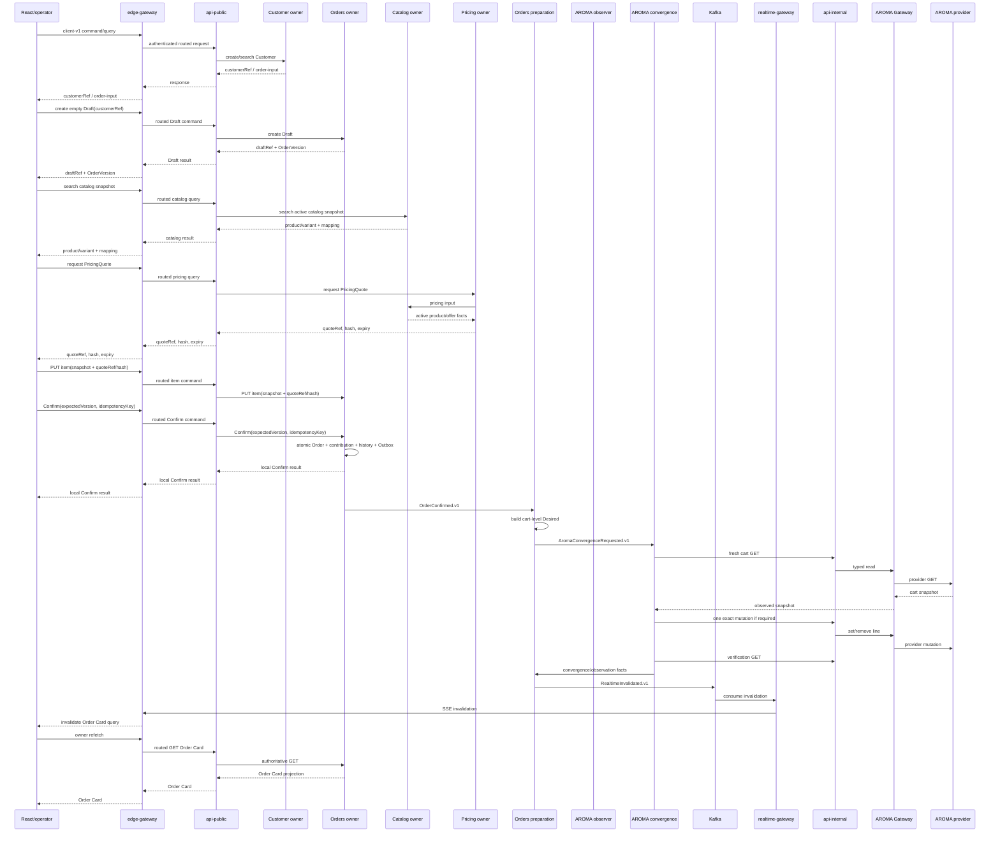
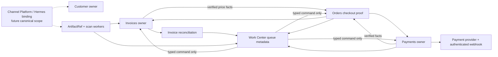

# Бизнес-сценарии

## Статус сценариев

Ниже один и тот же сценарий показан в трёх слоях: нормативная цепочка, найденная materialization и неизвестное. `[SPEC]` означает, что так должна работать архитектура; `[IMPLEMENTED-IN-CODE]` — соответствующий код найден; `[STUB/PLANNED]` — runtime/контракт заявлены, но предметный handler не найден; `[UNKNOWN]` — чтение репозитория не доказывает acceptance.

## Первая бизнес-цепочка: frontend journey и owner boundaries

Frontend journey нормативно такой: **Customer → создать Draft → найти в Catalog → получить PricingQuote → добавить item в Draft → Confirm**. Это порядок клиентского сценария; межвладельческие записи всё равно проходят через `edge-gateway` → `api-public`, а не напрямую из Browser в owner. ([docs/launch/02_FIRST_VERTICAL_SLICE.md:L3-L13], [docs/launch/01_RUNTIME_ARCHITECTURE.md:L33-L45])

### 1. Customer: найти или создать субъекта заказа

**[SPEC]** Оператор или клиентский интерфейс начинает с Customer: найти существующего клиента либо создать нового. Customer context владеет identity, contacts, addresses и channel links; эти данные хранятся в `coffee_platform_customer`. Owner API публикует create/search и internal `order-input`; другие сервисы не получают права записи в эту БД. ([docs/launch/14_CUSTOMER_IMPLEMENTATION_SPEC.md:L1-L22], [docs/launch/05_DATA_OWNERSHIP.md:L10-L19], [config/service-catalog.json:L52-L60])

**[IMPLEMENTED-IN-CODE]** В `customer-service` найден реальный composition root: он требует owner database и runtime context, поднимает ключи делегации для `api-public`/`api-internal`, создаёт Ed25519 cursor signer и регистрирует Customer routes. ([apps/customer-service/src/main.ts:L53-L82]) Командный слой проверяет `actorRef`, 64-символьный scope, UUID idempotency key и UUID correlation ID, затем нормализует `CustomerCreateRequest` и передаёт его в store. ([apps/customer-service/src/application/create-customer.ts:L21-L40]) HTTP layer также разделяет transport identity и делегацию, то есть модель или браузер не выбирают authoritative actor самостоятельно. ([apps/customer-service/src/http/index.ts:L1-L8], [apps/customer-service/src/http/index.ts:L21-L40])

**[UNKNOWN]** Не утверждается, что текущая БД содержит реальные клиенты, что public endpoint прошёл integration acceptance или что cursor rotation/PII controls проверены в live среде. Нормативная spec и source code — evidence of design/materialization, не runtime acceptance.

### 2. Catalog: искать товар только в сохранённом снимке

**[SPEC]** Catalog владеет products, variants, aliases, supplier snapshots, OfferMapping и availability. Интерактивный путь должен читать активированный сохранённый snapshot, а не синхронно ходить к supplier/provider. Полный supplier read поступает в Received generation; неполный snapshot закрывается отказом и не удаляет отсутствующий хвост; activation атомарно публикует mapping facts. ([docs/launch/15_CATALOG_IMPLEMENTATION_SPEC.md:L1-L24], [docs/launch/10_RUNTIME_CATALOG.md:L62-L89])

Catalog разделён на три runtime из-за разных ролей и failure profiles: `catalog-service` — read API; `catalog-supplier-sync` — bounded full import с readwrite-staging; `catalog-activation-worker` — activation и Catalog Outbox. Это один bounded context, но не один process. ([config/service-catalog.json:L62-L89])

**[STUB/PLANNED]** В snapshot все три app entrypoints содержат только `startConfiguredRuntime("...")`; source-level repository, supplier import, activation transaction и read routes в этих приложениях не найдены. ([apps/catalog-service/src/main.ts:L1-L3], [apps/catalog-supplier-sync/src/main.ts:L1-L3], [apps/catalog-activation-worker/src/main.ts:L1-L3]) Поэтому нельзя писать «Catalog работает»; корректная формулировка — «Catalog boundary и contracts специфицированы, runtime shells materialized».

### 3. Pricing: получить immutable PricingQuote

**[SPEC]** Pricing получает pricing input из Catalog, применяет версию policy, delivery coefficient и markup, возвращает серверно рассчитанный immutable quote с expiry и canonical hash. Quote должен быть versioned/time-bounded; клиентское значение денег не является авторитетом. Orders при подтверждении проверяет persisted quote reference/hash и не переоценивает подтверждённый заказ незаметно. ([docs/launch/16_PRICING_IMPLEMENTATION_SPEC.md:L1-L22], [docs/launch/00_SCOPE_AND_DECISIONS.md:L48-L57])

**[STUB/PLANNED]** Нормативный каталог определяет `POST /api/client-v1/pricing/quotes`, internal verification и БД `coffee_platform_pricing`, но `apps/pricing-service/src/main.ts` — только bootstrap. ([config/service-catalog.json:L92-L100], [apps/pricing-service/src/main.ts:L1-L3]) В коде не наблюдается materialized quote calculator, policy repository или verification handler; это не доказательство отсутствия во всём репозитории, но в обследованном app scope они не найдены.

### 4. Orders Draft: зафиксировать выбор и agreement snapshot

**[SPEC]** React создаёт пустой Draft для Customer, отдельной `PUT item` командой добавляет `quoteRef/hash` и server-verified product snapshot, затем подтверждает Draft с expected `OrderVersion` и `Idempotency-Key`. Orders владеет принятыми immutable snapshots, Order contribution, history и Outbox. ([docs/launch/02_FIRST_VERTICAL_SLICE.md:L3-L13], [docs/launch/17_ORDERS_IMPLEMENTATION_SPEC.md:L1-L28])

Draft допускает hard delete, но confirmed records меняются только командами и compensation. `Confirm` должен быть локальной атомарной транзакцией: status/version + immutable item/product/price snapshots + contribution + history/audit + Outbox. В ней нет HTTP к Catalog, Pricing или AROMA и нет distributed transaction. ([docs/launch/00_SCOPE_AND_DECISIONS.md:L48-L54], [docs/launch/05_DATA_OWNERSHIP.md:L26-L42])

**[STUB/PLANNED]** `orders-service` в app source содержит только runtime bootstrap. Поэтому Draft/Confirm contract и owner DB topology являются [SPEC], но текущий snapshot не даёт [IMPLEMENTED-IN-CODE] evidence для Order repository, command handler, transaction или Outbox writer. ([apps/orders-service/src/main.ts:L1-L3], [config/service-catalog.json:L102-L111])

### 5. После Confirm: Desired и AROMA convergence

**[SPEC]** После локального commit `orders-aroma-preparation` агрегирует contributions и mapping facts в cart-level Desired. Затем convergence получает lease/fence, выполняет fresh GET, резервирует максимум одну точную unsafe mutation и делает verification GET. Failed provider GET не очищает последнее Observed; потерянный ответ мутации означает `UnknownOutcome`, а не blind retry. ([docs/launch/01_RUNTIME_ARCHITECTURE.md:L12-L19], [docs/launch/00_SCOPE_AND_DECISIONS.md:L50-L57])

Состояния Order и AROMA ортогональны. Order lifecycle в первой вертикали — `Draft -> Confirmed`; AROMA state — `NotRequested`, `PendingObservation`, `OutOfSync`, `Converging`, `InSync`, `Blocked`, `UnknownOutcome`. ([docs/launch/01_RUNTIME_ARCHITECTURE.md:L21-L39]) Physical truth требует свежего успешного observation. Orders владеет Desired, Observed, Convergence, Attempt, Lease и Fence; AROMA Gateway владеет только provider session/protocol/HTTP. ([docs/launch/00_SCOPE_AND_DECISIONS.md:L48-L57], [docs/launch/05_DATA_OWNERSHIP.md:L10-L24])

**[IMPLEMENTED-IN-CODE]** AROMA Gateway materialized source соответствует именно adapter boundary: main проверяет HTTPS origin/port/redirect policy, ограничивает provider response, создаёт encrypted session manager, catalog export boundary, cart reader, offer bindings, mutation journal и executor, затем регистрирует binding/catalog/cart/mutation routes. ([apps/aroma-gateway/src/main.ts:L32-L45], [apps/aroma-gateway/src/main.ts:L59-L113]) Journal model различает `Reserved`, `Dispatched`, `Acknowledged`, `Rejected`, `UnknownOutcome` и валидирует typed response bytes/failure codes; это подтверждает durable protocol design внутри gateway. ([apps/aroma-gateway/src/domain/mutation-journal.ts:L160-L185], [apps/aroma-gateway/src/infrastructure/database/provider-mutation-journal.ts:L160-L184])

**[STUB/PLANNED]** Самый важный Orders-side orchestration отсутствует в app source: `orders-aroma-preparation`, `aroma-observer` и `aroma-convergence` имеют только bootstrap. Следовательно, найденная реализация gateway не равна доказанной end-to-end convergence. ([apps/orders-aroma-preparation/src/main.ts:L1-L3], [apps/aroma-observer/src/main.ts:L1-L3], [apps/aroma-convergence/src/main.ts:L1-L3])

### Sequence: нормативная первая вертикаль

Схема — [SPEC]. Draft создаётся до Catalog/quote, как требует frontend spec. Confirm не ждёт межвладельческих HTTP-вызовов: локальный commit Orders сначала фиксирует Order, contribution, history и Outbox; cart-level Desired строится после commit. Browser не вызывает owner напрямую, Kafka event не приходит в Browser напрямую: путь invalidation — Kafka → realtime-gateway → Edge → SSE → refetch. В этом срезе runtime acceptance не заявляется; app entrypoints для Orders/workers/realtime остаются bootstrap-only.

## Событийная связка первой волны

**[SPEC]** Launch envelope содержит `messageId`, `occurredAt`, trace, causation, correlation и owner aggregate version. Всего 7 сообщений и 6 distinct business topics: `AromaObservationChanged` и `AromaConvergenceChanged` разделяют `coffee.aroma.cart.events.v1`. Transport at-least-once; business effect — effectively-once через Inbox/state guards; offsets commit только после durable processing. ([docs/launch/06_EVENTS_AND_RECOVERY.md:L3-L24], [docs/launch/06_EVENTS_AND_RECOVERY.md:L26-L53])

Ключевые связи: Catalog activation публикует mapping; Orders preparation потребляет mapping и `OrderConfirmed`; convergence получает command по `cartScopeRef`; observer/convergence публикуют observations; realtime получает invalidation по `subjectRef`. [SPEC] ([docs/launch/06_EVENTS_AND_RECOVERY.md:L13-L36])

**[UNKNOWN]** Контрактные JSON Schema и generic Kafka foundation существуют в репозитории, но это не доказывает, что каждый заявленный consumer зарегистрирован в working business runtime. В snapshot отсутствует business composition для большинства owner paths; remote status issues/PRs #61–#64 не проверялся и здесь не оценивается. ([docs/launch/06_EVENTS_AND_RECOVERY.md:L141-L171], [packages/platform-kafka-runtime/src/index.ts:L1-L20], [apps/orders-service/src/main.ts:L1-L3])

## Вторая волна: Invoices, Payments, Artifacts, Work Center и каналы

### Invoices и supplier documents

**[SPEC / PLANNED]** Wave 2 продолжает первую вертикаль в сторону supplier procurement/invoice materialization, allocation и reconciliation. `Invoices` должен владеть `ClientInvoice`, lines, allocations, document metadata, immutable price proof, materialization Inbox, reconciliation и compensation state; нормальное создание начинается с immutable Orders checkout/allocation proof, а не с голого `OrderConfirmed`. Это подтверждено каноном M10, а README W2 фиксирует только план и незакрытые входы. ([docs/CoffeeOrderSystem_CANONICAL_Architecture_EndToEndHardened_RU_2026-08-19/M10_INVOICES/01_INVOICES_MIGRATION.md:L3-L31], [docs/CoffeeOrderSystem_CANONICAL_Architecture_EndToEndHardened_RU_2026-08-19/M10_INVOICES/02_CHECKOUT_MATERIALIZATION_AND_PRICE_PROOF.md:L3-L37], [docs/wave-2/README.md:L39-L47])

Supplier document ingestion имеет отдельную границу: сначала ArtifactRef/hash/size/type и quarantine/scan, затем bounded parser worker, затем owner validation и explicit review/recovery для partial/unknown documents. Invoices не должен выполнять parsing/scanning в API request path или делать cross-owner SQL. ([docs/CoffeeOrderSystem_CANONICAL_Architecture_EndToEndHardened_RU_2026-08-19/M04_TYPESCRIPT_PLATFORM/07_ARTIFACT_STORAGE_BOUNDARY.md:L3-L49], [docs/CoffeeOrderSystem_CANONICAL_Architecture_EndToEndHardened_RU_2026-08-19/M10_INVOICES/03_ALLOCATION_MANIFEST_AND_PRICE_PROOF_CONTRACT.md:L3-L65])

**[STUB/PLANNED]** В launch scope invoices, supplier invoice materialization и checkout AROMA явно вынесены из первого запуска; в обследованных `apps/` отдельного invoice runtime не найдено. ([docs/launch/00_SCOPE_AND_DECISIONS.md:L40-L46], [docs/wave-2/README.md:L1-L28])

### Artifacts

**[SPEC]** Большие документы, manifests, media и exports должны жить как immutable `ArtifactRef` с hash, size, media type, owner, classification и retention. Bytes не передаются через Kafka и не обрабатываются в интерактивном API loop; consumer проверяет owner/type/schema, byteSize и SHA-256 перед использованием, а бизнес-владельцы хранят ссылки/proofs. ([docs/CoffeeOrderSystem_CANONICAL_Architecture_EndToEndHardened_RU_2026-08-19/M04_TYPESCRIPT_PLATFORM/07_ARTIFACT_STORAGE_BOUNDARY.md:L3-L49])

Это означает, что invoice PDF, supplier export, channel media и transcription — не доменные payloads Orders/Payments. Владелец хранит reference и проверенный hash; access — bounded, signed, short-lived. **[UNKNOWN]** Конкретный object store, retention job и production scanner в snapshot не подтверждены.

### Payments

**[SPEC / PLANNED]** Payments должен владеть PaymentIntent, Attempt, WebhookInbox, Refund, provider proof и reconciliation и никогда не писать Orders storage. Сумма и валюта приходят только из durable server-owned `OrderPaymentRequired`, возникающего после invoice/price proof и `AwaitingCustomerPayment`; card data не проходит через business services, Kafka, logs или Hermes. Browser redirect не является proof: нужен authenticated webhook и/или provider reconciliation. ([docs/CoffeeOrderSystem_CANONICAL_Architecture_EndToEndHardened_RU_2026-08-19/M08_PAYMENTS/01_PAYMENTS_ARCHITECTURE.md:L3-L55], [docs/CoffeeOrderSystem_CANONICAL_Architecture_EndToEndHardened_RU_2026-08-19/M10_INVOICES/02_CHECKOUT_MATERIALIZATION_AND_PRICE_PROOF.md:L35-L37])

Timeout внешнего provider create/refund — `UnknownOutcome`: после reconnect выполняется lookup/reconciliation по стабильной provider identity, но blind-create и автоматическая смена provider запрещены. `PaymentSucceeded` проходит Inbox/correlation/amount checks в Orders и duplicate является no-op; refund не переписывает Order lifecycle автоматически, late success после cancellation не resurrects Order. Webhook ingress отделён от outbound workers. **[STUB/PLANNED]** В launch scope payments исключён; provider ingress и Payments business runtime в обследованном scope не найдены. ([docs/CoffeeOrderSystem_CANONICAL_Architecture_EndToEndHardened_RU_2026-08-19/M08_PAYMENTS/02_ORDER_PAYMENT_HANDOFF_AND_MANUAL_FALLBACK.md:L18-L41], [docs/CoffeeOrderSystem_CANONICAL_Architecture_EndToEndHardened_RU_2026-08-19/M08_PAYMENTS/03_REFUND_CANCELLATION_AND_COMPENSATION.md:L17-L63], [docs/CoffeeOrderSystem_CANONICAL_Architecture_EndToEndHardened_RU_2026-08-19/M08_PAYMENTS/04_PAYMENT_RUNTIME_TOPOLOGY_AND_WEBHOOK.md:L14-L38], [docs/launch/00_SCOPE_AND_DECISIONS.md:L40-L46])

### Work Center

**[SPEC / PLANNED]** Work Center — не бизнес-владелец и не универсальный repair API. Он владеет только queue/read model и projection metadata. Операторская команда должна маршрутизироваться в typed command owning context с actor, capability, reason, expected version/fingerprint и idempotency key. `Acknowledged`, `Snoozed`, `Resolved` — queue metadata, а не бизнес-завершение; queue resolves только после authoritative owner fact. ([docs/CoffeeOrderSystem_CANONICAL_Architecture_ContractClosure_RU_2026-08-22/M21_OPERATOR_WORK_CENTER/OWNER_COMMAND_ALLOWLIST_AND_AUDIT.md:L3-L48])

Work Center особенно важен для `UnknownOutcome`, partial supplier document, stale projection, payment reconciliation и blocked AROMA. Он не может напрямую менять Order, Payment, Invoice, Customer, Catalog или AROMA через SQL. **[STUB/PLANNED]** Отдельного Work Center runtime в launch catalog нет; его delivery относится к последующей волне.

### Channel Platform и Hermes/VK

**[SPEC / FUTURE CANONICAL SCOPE]** Channel Platform владеет transport identity ledger, inbound/outbound delivery и provider verification; Agent Platform владеет turn routing/journal и Hermes binding. Ни одна не владеет истиной Customer, Catalog, Pricing или Orders. Provider callback проверяется до durable intake; сохраняются channel ordering, dedupe IDs и bounded backpressure. Это канон M09, не описание незакрытых входов W2. ([docs/CoffeeOrderSystem_CANONICAL_Architecture_EndToEndHardened_RU_2026-08-19/M09_HERMES_VK/README.md:L3-L23], [docs/CoffeeOrderSystem_CANONICAL_Architecture_EndToEndHardened_RU_2026-08-19/M09_HERMES_VK/02_VK_TO_HERMES_FLOW.md:L13-L43], [docs/CoffeeOrderSystem_CANONICAL_Architecture_EndToEndHardened_RU_2026-08-19/M09_HERMES_VK/06_EDA8_HERMES_RUNTIME_INTEGRATION.md:L5-L38], [docs/CoffeeOrderSystem_CANONICAL_Architecture_EndToEndHardened_RU_2026-08-19/M09_HERMES_VK/08_CHANNEL_IDENTITY_BROKER_CONTRACT.md:L3-L27])

Канальная модель не может авторизовать подтверждение заказа, payment или AROMA mutation через LLM output. Identity resolve выполняется по trusted evidence, а confirmation — через trusted channel proof; media проходит через ArtifactRef и bounded workers. Hermes/VK **не входят в обязательный W2 cycle**: README W2 прямо исключает их из mandatory cycle; здесь они отмечены как broader canonical future scope M09, не как W2 deliverable. ([docs/CoffeeOrderSystem_CANONICAL_Architecture_EndToEndHardened_RU_2026-08-19/M09_HERMES_VK/04_CHANNEL_IDENTITY_AND_CUSTOMER_RESOLUTION.md:L21-L57], [docs/CoffeeOrderSystem_CANONICAL_Architecture_EndToEndHardened_RU_2026-08-19/M09_HERMES_VK/07_AI_VK_CONFIRMATION_AND_APPROVAL_PROOF.md:L3-L21], [docs/CoffeeOrderSystem_CANONICAL_Architecture_EndToEndHardened_RU_2026-08-19/M04_TYPESCRIPT_PLATFORM/07_ARTIFACT_STORAGE_BOUNDARY.md:L3-L49], [docs/wave-2/README.md:L106-L108])

### Схема второй волны

Схема фиксирует ownership, а не текущую реализацию. Пунктиром отмечен broader M09 future scope, не обязательный W2 cycle. Строки W2 `README.md:L110-L120` описывают незакрытые входы (AROMA invoice read, provider identity, submit, PSP, quantity/money, document matching, topology), а не Channel Platform. Wave 2 нельзя использовать как доказательство того, что launch runtime уже принимает invoices, payments, media, Hermes/VK или operator recovery.

## Сводка наблюдений и assumptions

**Наблюдения:** Customer и AROMA Gateway имеют значимый source-level code; platform runtime и API composition roots materialized частично; Catalog/Pricing/Orders orchestration/realtime app entrypoints — bootstrap-only; нормативные документы подробно описывают desired contracts, owner boundaries, event names и recovery semantics. ([apps/customer-service/src/main.ts:L53-L82], [apps/aroma-gateway/src/main.ts:L47-L162], [apps/catalog-service/src/main.ts:L1-L3], [apps/orders-service/src/main.ts:L1-L3])

**Assumptions, которые не следует превращать в факты:** наличие `dist/` не означает acceptance; наличие Compose service не означает healthy runtime; наличие contract catalog не означает подключённого consumer; наличие provider adapter не означает успешного внешнего AROMA session; наличие wave-2 документа не означает реализованный Invoices/Payments/Artifacts/Work Center/Channels.

## Проверяемые ключевые числа

- первая launch цепочка использует 15 runtime, 7 launch messages, 6 distinct business topics и 5 owner DB boundaries; это числа каталога/authority package, не результат runtime acceptance. ([config/service-catalog.json:L9-L10], [docs/launch/06_EVENTS_AND_RECOVERY.md:L13-L36], [docs/adr/ADR-0025-fastify-launch-recovery.md:L6-L8])
- в source-level inspection найдено 11 bootstrap-only app entrypoints из 15; два substantive business app areas — Customer и AROMA Gateway, а `api-public`/`api-internal` materialized как частичные composition roots. Это проверяемое свойство snapshot по `apps/*/src/main.ts`, а не обещание покрытия всего репозитория.
- первая волна прямо исключает Invoices, Payments, Hermes/VK, Work Center commands, supplier invoice materialization и checkout AROMA. ([docs/launch/00_SCOPE_AND_DECISIONS.md:L40-L46])

## Источники

- [Источник](../../docs/launch/01_RUNTIME_ARCHITECTURE.md#L1-L50)
- [Источник](../../docs/launch/02_FIRST_VERTICAL_SLICE.md#L1-L50)
- [Источник](../../docs/launch/05_DATA_OWNERSHIP.md#L10-L42)
- [Источник](../../docs/launch/06_EVENTS_AND_RECOVERY.md#L3-L61)
- [Источник](../../docs/wave-2/README.md#L1-L148)
- [Источник](../../docs/wave-2/01_AROMA_SUPPLIER_INVOICES.md#L1-L86)
- [Источник](../../config/service-catalog.json#L9-L163)
- [Источник](../../apps/customer-service/src/main.ts#L53-L82)
- [Источник](../../apps/aroma-gateway/src/main.ts#L32-L162)
- [Источник](../../apps/aroma-gateway/src/domain/mutation-journal.ts#L160-L185)
- [Источник](../../apps/orders-service/src/main.ts#L1-L3)

## Связанные главы

- [00_Атлас архитектуры](README.md)
- [03_Данные и владение](03_%D0%94%D0%B0%D0%BD%D0%BD%D1%8B%D0%B5%20%D0%B8%20%D0%B2%D0%BB%D0%B0%D0%B4%D0%B5%D0%BD%D0%B8%D0%B5.md)
- [08_AROMA сходимость](08_AROMA%20%D1%81%D1%85%D0%BE%D0%B4%D0%B8%D0%BC%D0%BE%D1%81%D1%82%D1%8C.md)

Машиночитаемые каталоги и общий manifest источников: [11_Источники и проверка](11_%D0%98%D1%81%D1%82%D0%BE%D1%87%D0%BD%D0%B8%D0%BA%D0%B8%20%D0%B8%20%D0%BF%D1%80%D0%BE%D0%B2%D0%B5%D1%80%D0%BA%D0%B0.md).
