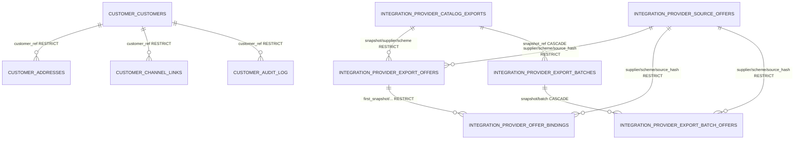
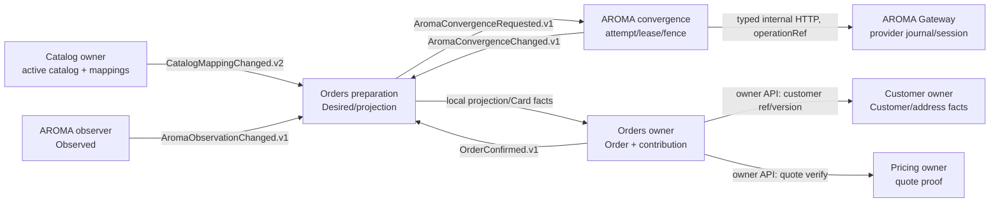

# 04. Схема PostgreSQL

[00_Атлас архитектуры](README.md) · [03_Данные и владение](03_%D0%94%D0%B0%D0%BD%D0%BD%D1%8B%D0%B5%20%D0%B8%20%D0%B2%D0%BB%D0%B0%D0%B4%D0%B5%D0%BD%D0%B8%D0%B5.md) · [08_AROMA сходимость](08_AROMA%20%D1%81%D1%85%D0%BE%D0%B4%D0%B8%D0%BC%D0%BE%D1%81%D1%82%D1%8C.md)

## 1. Как читать каталог

Ниже перечислены **конкретные SQL-сущности, выраженные в исходниках миграций**, и отдельно — сущности, которые спроектированы в launch package, но не имеют текущего `CREATE TABLE` в snapshot репозитория. «Фактическая» означает наличие SQL DDL в tracked migration file; это не означает, что migration реально применена к PostgreSQL. Live introspection намеренно не выполнялась.

В текущем snapshot — 9 SQL-файлов миграций: Customer `0001–0002`, Integration `0001–0007`. Они создают 13 конкретных таблиц: 5 в `customer` и 8 в `integration`. `platform_schema_migrations` создаётся только общим runtime runner-ом при вызове `applyMigrations`; вызова runner-а и deployed ledger здесь нет, поэтому эта техническая ledger-таблица не считается service-local migration table и не входит в 13 actual tables. Catalog/Pricing/Orders business tables находятся в specification/role map, но не в actual migration SQL.

Проверка девяти SQL-файлов дала 13 `CREATE TABLE`, 10 фактических FK и 14 явно именованных вторичных индексов (8 Customer, 6 Integration). Первичные ключи и дополнительные `UNIQUE`-правила перечислены по каждой таблице ниже; cross-owner FK отсутствуют.

Типовые семантики:

- `varchar` refs — opaque IDs с regex checks; формат ID не заменяет межсервисную FK.
- `char(64)` — lowercase SHA-256/HMAC-derived digest, не raw provider identity.
- `timestamptz` — абсолютное время; defaults используют PostgreSQL clock.
- `bigint`/`integer` counts — exact integer domains; деньги не представлены `float`.
- `jsonb`/`bytea` payloads требуют canonical hash и bounded size/typed schema на application boundary.

**Источники:** `apps/customer-service/migrations/0001_customer_schema.sql:1-104`, `apps/aroma-gateway/migrations/0001_provider_sessions.sql:1-20`, `packages/platform-migrations/src/index.ts:100-129`, `docs/launch/09_EXISTING_DATABASE_AND_VERSIONS.md:21-42`; таблица источников: [P01–P05](#таблица-источников); [Источник](../../packages/platform-migrations/src/index.ts)

## 2. Фактический каталог: Customer DB / schema `customer`

### `customer.customers`

| Аспект | Содержание |
|---|---|
| Миграция/путь | `apps/customer-service/migrations/0001_customer_schema.sql:3-21` |
| Существенные колонки/типы | `customer_ref varchar(30)`, `version bigint`, `display_name varchar(200)`, `display_name_search varchar(200)`, nullable `phone_e164 varchar(16)`, nullable `email_normalized varchar(254)`, `status varchar(16)`, `created_at/updated_at timestamptz`, `created_by_actor_ref/updated_by_actor_ref varchar(128)` |
| PK | `customer_ref` |
| FK | нет |
| UNIQUE | PK; partial unique index active phone; partial unique index active email |
| CHECK | ULID-like `cus_...`; version > 0; status Active/Inactive; at least phone or email; E.164 phone; `display_name_search = lower(display_name)`; non-empty actor refs |
| Индексы | `customers_active_phone_uq` on `(phone_e164)` WHERE Active/non-null; `customers_active_email_uq` on `(email_normalized)` WHERE Active/non-null; `customers_display_name_search_idx` on `(display_name_search text_pattern_ops, customer_ref)`; `customers_phone_idx`; `customers_email_idx` |
| Писатель/runtime | только `customer-service`; repository INSERT/search/read Order input. Роль: `coffee_customer_rw` |
| Идемпотентность/транзакция | Создаётся в одной транзакции с optional address, audit row и завершением Customer idempotency |
| Инвариант | Один активный владелец на нормализованные phone/email; public version начинается с 1 и является optimistic-concurrency token |

### `customer.addresses`

| Аспект | Содержание |
|---|---|
| Миграция/путь | `0001_customer_schema.sql:23-42`; active-address index `0002_customer_indexes.sql:13-15` |
| Существенные колонки/типы | `address_ref varchar(30)`, `customer_ref varchar(30)`, `kind varchar(16)`, `line1/line2 varchar(200)`, `city varchar(120)`, `postal_code varchar(20)`, `country_code char(2)`, `version bigint`, `is_active boolean`, audit timestamps и actor refs |
| PK | `address_ref` |
| FK | `customer_ref → customer.customers(customer_ref) ON DELETE RESTRICT` |
| UNIQUE | partial unique `(customer_ref)` WHERE `kind='Delivery' AND is_active` |
| CHECK | `adr_...` ref; kind exactly Delivery; non-empty line1/city; country two uppercase letters; version > 0; non-empty actor refs |
| Индексы | `addresses_active_delivery_customer_uq` partial unique; других явных индексов в миграции нет (для FK lookup при росте нагрузки может потребоваться будущий неуникальный индекс) |
| Писатель/runtime | только `customer-service` |
| Идемпотентность/транзакция | Optional row вставляется после Customer в той же транзакции Customer aggregate |
| Инвариант | Не более одного активного Delivery-адреса на Customer; удаление родителя ограничено |

### `customer.channel_links`

| Аспект | Содержание |
|---|---|
| Миграция/путь | `0001_customer_schema.sql:44-58`; active identity index `0002_customer_indexes.sql:9-11` |
| Существенные колонки/типы | `channel_link_ref varchar(30)`, `customer_ref varchar(30)`, `provider varchar(16)`, `external_subject_hash char(64)`, `status varchar(16)`, created/updated timestamps и actor refs |
| PK | `channel_link_ref` |
| FK | `customer_ref → customer.customers(customer_ref) ON DELETE RESTRICT` |
| UNIQUE | partial unique `(provider, external_subject_hash)` WHERE `status='Active'` |
| CHECK | `chl_...`; provider Web/VK; external hash lowercase 64 hex; status Active/Revoked; non-empty actor refs |
| Индексы | `channel_links_active_subject_uq` partial unique |
| Писатель/runtime | `customer-service`; отдельного channel-specific SQL writer в текущем исходнике нет |
| Идемпотентность/транзакция | Generic Inbox/Outbox column или table FK отсутствуют; изменения link должны оставаться Customer-owned |
| Инвариант | Один активный channel subject отображается на одного Customer на provider; revoked link может сохраняться исторически |

### `customer.idempotency_records`

| Аспект | Содержание |
|---|---|
| Миграция/путь | `0001_customer_schema.sql:60-83`; expiry index `0002_customer_indexes.sql:26-27` |
| Существенные колонки/типы | `actor_ref varchar(64)`, `scope varchar(64)`, `idempotency_key uuid`, `request_hash char(64)`, `state varchar(16)`, `lease_owner uuid`, `lease_until/created_at/expires_at/completed_at timestamptz`, `response_status smallint`, `response_body jsonb`, `resource_ref varchar(30)` |
| PK | `(actor_ref, scope, idempotency_key)` |
| FK/UNIQUE | no FK; PK is identity uniqueness |
| CHECK | actor/scope non-empty; hash 64 lowercase hex; state Acquired/Completed; `expires_at >= lease_until > created_at`; Acquired has no response/status/completed_at; Completed has status 100..599, body and completed_at |
| Индексы | `idempotency_records_expires_at_idx` on `expires_at` |
| Писатель/runtime | `customer-service`; `SqlIdempotencyStore` настроен на схему `customer`, таблицу `idempotency_records` |
| Поведение идемпотентности | Replay при точном request hash; mismatch даёт conflict; active lease означает in progress; completion сохраняет response/body/resource ref |
| Инвариант | Cleanup не должен удалять незавершённый/неизвестный intent; retention completed-записей — политика владельца |

### `customer.audit_log`

| Аспект | Содержание |
|---|---|
| Миграция/путь | `0001_customer_schema.sql:85-97` |
| Существенные колонки/типы | `audit_ref varchar(30)`, `customer_ref varchar(30)`, `operation varchar(32)`, `actor_ref varchar(128)`, `correlation_id uuid`, `occurred_at timestamptz`, nullable `before_hash char(64)`, `after_hash char(64)` |
| PK | `audit_ref` |
| FK | `customer_ref → customer.customers(customer_ref) ON DELETE RESTRICT` |
| UNIQUE | PK only |
| CHECK | `aud_...`; operation exactly CustomerCreated; actor non-empty; after hash required; before hash null or 64 hex |
| Индексы | no explicit secondary index |
| Писатель/runtime | `customer-service`; только INSERT через role grant |
| Транзакционный инвариант | Audit row добавляется в той же транзакции, что и создание aggregate; для committed-записи без Customer audit отсутствует |

**Источники всего Customer-каталога:** `apps/customer-service/migrations/0001_customer_schema.sql:3-104`, `apps/customer-service/migrations/0002_customer_indexes.sql:1-27`, `apps/customer-service/src/infrastructure/postgres/customer-repository.ts:122-239`, `apps/customer-service/src/infrastructure/postgres/customer-store.ts:73-112`; source table: [P06–P09](#таблица-источников); [Источник](../../apps/customer-service/migrations/0001_customer_schema.sql)

## 3. Фактический каталог: Integration DB / schema `integration`

### `integration.provider_sessions`

| Аспект | Содержание |
|---|---|
| Миграция/путь | `apps/aroma-gateway/migrations/0001_provider_sessions.sql:1-20` |
| Существенные колонки/типы | `scope_hash char(64)`, `encrypted_cookie_material bytea`, nullable `expires_at timestamptz`, `created_at/updated_at timestamptz` |
| PK/UNIQUE/FK | PK `scope_hash`; FK нет; других unique нет |
| CHECK | scope hash lowercase hex 64; encrypted material 32..65536 bytes |
| Индексы | partial `provider_sessions_expiry_idx` on expires_at WHERE non-null |
| Писатель/runtime | `aroma-gateway`; SELECT/INSERT/UPDATE/DELETE |
| Инвариант безопасности | Durable является только шифрованный envelope; расшифрованная cookie существует только в памяти и очищается при shutdown; представления provider credentials/body отсутствуют |

### `integration.provider_mutation_journal`

| Аспект | Содержание |
|---|---|
| Миграция/путь | base `0002_provider_mutation_journal.sql:3-72`; `retention_until` в `0006:1-16`; `source_grind_key_hash` в `0007:1-3` |
| Существенные колонки/типы | `operation_ref varchar(30)`; `cart_scope_ref varchar(64)`; `operation_kind varchar(32)`; `offer_ref varchar(30)`; nullable positive `quantity_milli bigint`; optional `source_grind_key_hash char(64)`; `request_hash char(64)`; caller/original caller/operation IDs; correlation/trace; state; reservation UUID/lease; provider/response fields; response bytes; created/started/dispatched/completed/last_seen timestamps; обязательный `retention_until timestamptz` |
| PK/UNIQUE/FK | PK `operation_ref`; FK к Orders/Catalog нет |
| CHECK | Cart scope exactly aroma-primary; operation SetLineQuantity requires positive quantity, RemoveLine requires NULL; IDs/hashes/callers/trace formats; lease > created; Reserved has no dispatched_at; Reserved/Dispatched have no outcome; Acknowledged requires 200 + body + outcome hash + completed; Rejected requires 4xx/5xx + body + failure + outcome; UnknownOutcome requires failure, no provider response/body, completed_at |
| Индексы | reservation `(state, lease_until)`; dispatched partial `(state, dispatched_at)`; retention partial `(retention_until, operation_ref)` для `Acknowledged`/`Rejected`/`UnknownOutcome` |
| Писатель/runtime | `aroma-gateway`; SELECT/INSERT/UPDATE и DELETE для cleanup, grant добавлен `0006`; только техническая идемпотентность Gateway |
| Lease/fencing | reservation owner UUID и lease; dispatch CAS — отдельная короткая транзакция; stale/unknown operation никогда не replay-ится вслепую |
| Хранение | 90 дней после terminal completion; фактические partial index и cleanup охватывают `Acknowledged`, `Rejected`, `UnknownOutcome`. Удаление допускается после `retention_until`, не сразу при unknown. Источники: `docs/launch/22_AROMA_GATEWAY_OPERATION_JOURNAL.md:67-84`; `apps/aroma-gateway/src/infrastructure/database/provider-mutation-journal.ts:469-489`. Вечное хранение unknown не подтверждено источником; совместимость с Orders recovery horizon в этом аудите не испытана. |

### `integration.provider_catalog_exports`

| Аспект | Содержание |
|---|---|
| Миграция/путь | base table `0003_offer_bindings.sql:3-18`; counters/hash columns `0005_catalog_export_attempts.sql:13-20` |
| Существенные колонки/типы | `snapshot_ref varchar(30)`, `supplier_ref varchar(30)`, identity scheme, state Exporting/Completed/Failed, optional content hash, timestamps, nonnegative `batch_count/product_count/variant_count/offer_count/next_batch_number`, optional `last_batch_hash` |
| PK/UNIQUE/FK | PK `snapshot_ref`; явный UNIQUE `(snapshot_ref,supplier_ref,source_identity_scheme)`; родительского FK нет |
| CHECK | snapshot/supplier formats; scheme exactly hmac-sha256-v1; hash formats; Completed requires content_hash; counts >= 0 |
| Индексы | PK/unique indexes only; no explicit secondary |
| Писатель/runtime | `aroma-gateway`; SELECT/INSERT/UPDATE |
| Инвариант | Snapshot generation и content hash — факты provider export; завершение нельзя подтвердить без content hash |

### `integration.provider_source_offers`

| Аспект | Содержание |
|---|---|
| Миграция/путь | base `0003_offer_bindings.sql:20-31`; raw identity fields `0004_provider_offer_identity.sql:1-16`; source product/variant hashes `0005_catalog_export_attempts.sql:1-11` |
| Существенные колонки/типы | composite identity `(supplier_ref varchar(30), source_identity_scheme varchar(32), source_offer_key_hash char(64))`; `raw_provider_offer_id varchar(256)`; optional raw product/variant/packing/grind IDs; optional source product/variant hashes; `created_at timestamptz` |
| PK/UNIQUE/FK | PK composite identity; UNIQUE `(supplier_ref, source_identity_scheme, raw_provider_offer_id)`; no parent FK |
| CHECK | supplier/scheme/hash formats; raw offer non-empty; optional raw IDs non-empty when present; optional source hashes 64 hex |
| Индексы | unique raw identity index plus explicit `provider_source_offers_identity_idx` on `(raw_provider_offer_id, provider_packing, provider_grind_id)` |
| Писатель/runtime | `aroma-gateway`; SELECT/INSERT |
| Инвариант | Стабильная opaque source identity переживает provider export; raw provider IDs хранятся только во владении Integration |

### `integration.provider_export_offers`

| Аспект | Содержание |
|---|---|
| Миграция/путь | `0003_offer_bindings.sql:33-45` |
| Существенные колонки/типы | `snapshot_ref`, `supplier_ref`, `source_identity_scheme`, `source_offer_key_hash` |
| PK | composite `(snapshot_ref,supplier_ref,source_identity_scheme,source_offer_key_hash)` |
| FK | composite → `provider_catalog_exports(snapshot_ref,supplier_ref,source_identity_scheme)` RESTRICT; composite → `provider_source_offers(supplier_ref,source_identity_scheme,source_offer_key_hash)` RESTRICT |
| UNIQUE/CHECK/индексы | PK index; других явных нет; форматы родительских ключей проверяются в родительских таблицах |
| Писатель/runtime | `aroma-gateway`; SELECT/INSERT |
| Инвариант | Принадлежность offer допустима только для указанного export snapshot и известного source offer |

### `integration.provider_offer_bindings`

| Аспект | Содержание |
|---|---|
| Миграция/путь | `0003_offer_bindings.sql:47-67` |
| Существенные колонки/типы | `offer_ref`, `supplier_ref`, identity scheme, `source_offer_key_hash`, `first_snapshot_ref`, state default Bound, created_at |
| PK/UNIQUE/FK | PK `offer_ref`; UNIQUE `(supplier_ref,scheme,source_offer_key_hash)`; FK to source_offers composite RESTRICT; FK `(first_snapshot_ref,supplier_ref,scheme,source_offer_key_hash)` → export_offers RESTRICT |
| CHECK | offer/supplier/hash/snapshot formats; scheme hmac-sha256-v1; state exactly Bound |
| Индексы | PK and unique indexes; no explicit secondary |
| Писатель/runtime | `aroma-gateway`; SELECT/INSERT |
| Инвариант | Один стабильный public `offer_ref` на source identity; первый snapshot должен содержать source offer |

### `integration.provider_export_batches`

| Аспект | Содержание |
|---|---|
| Миграция/путь | `0005_catalog_export_attempts.sql:22-33` |
| Существенные колонки/типы | `snapshot_ref varchar(30)`, `batch_number integer`, `offer_count integer`, `uncompressed_bytes integer`, `batch_hash char(64)`, nullable `previous_batch_hash char(64)`, `created_at timestamptz` |
| PK/FK | PK `(snapshot_ref,batch_number)`; FK snapshot_ref → provider_catalog_exports(snapshot_ref) CASCADE |
| CHECK | batch number >= 0; offer count 1..500; bytes 2..2097152; hashes lowercase 64 hex |
| Индексы | PK index |
| Писатель/runtime | `aroma-gateway`; SELECT/INSERT/DELETE |
| Инвариант | Цепочка batch использует предыдущий hash; удаление export каскадирует batch rows, а source identities защищены ссылками RESTRICT |

### `integration.provider_export_batch_offers`

| Аспект | Содержание |
|---|---|
| Миграция/путь | `0005_catalog_export_attempts.sql:35-52` |
| Существенные колонки/типы | `snapshot_ref`, `batch_number`, `ordinal`, `supplier_ref`, identity scheme, `source_offer_key_hash` |
| PK/UNIQUE/FK | PK `(snapshot_ref,batch_number,ordinal)`; UNIQUE `(snapshot_ref,source_offer_key_hash)`; FK to export_batches CASCADE; FK to source_offers RESTRICT |
| CHECK | ordinal 0..499; source hash lowercase 64 hex |
| Индексы | `provider_export_batch_offers_source_idx` on `(supplier_ref,scheme,source_offer_key_hash)` plus PK/unique indexes |
| Писатель/runtime | `aroma-gateway`; SELECT/INSERT/DELETE |
| Инвариант | Один source offer появляется в snapshot не более одного раза; ordinal ограничен ёмкостью batch |

**Источники Integration-каталога:** файлы миграций `0001_provider_sessions.sql:1-20`, `0002_provider_mutation_journal.sql:1-72`, `0003_offer_bindings.sql:1-72`, `0004_provider_offer_identity.sql:1-16`, `0005_catalog_export_attempts.sql:1-57`, `0006_provider_mutation_retention.sql:1-16`, `0007_provider_mutation_grind.sql:1-3`; runtime writers `provider-session-store.ts`, `provider-mutation-journal.ts`, `offer-binding-store.ts`, `provider-catalog-source.ts`; таблица источников: [P10–P17](#таблица-источников); [Источник](../../apps/aroma-gateway/migrations/0005_catalog_export_attempts.sql)

## 4. Фактическая FK ER-диаграмма

Эта диаграмма показывает только PostgreSQL FK из фактического SQL. Composite FK изображены как relationship; состав колонок приведён в каталоге выше. Межсервисные `customer_ref`, `offer_ref`, `supplier_ref`, `snapshot_ref` между разными owner DB здесь намеренно отсутствуют.

У Mermaid entity names нет точек и composite column declarations, чтобы диаграмма оставалась совместимой с простым renderer syntax. Она не утверждает relationship между `customer.customers` и `orders.orders`, между Catalog и Integration или между Orders и Gateway: таких SQL FK в разных databases/schema не должно быть.

**Источники:** фактические FK clauses `apps/customer-service/migrations/0001_customer_schema.sql:23-27,44-48,85-89`, `apps/aroma-gateway/migrations/0003_offer_bindings.sql:33-45,61-66`, `apps/aroma-gateway/migrations/0005_catalog_export_attempts.sql:31-33,43-49`; [Источник](../../apps/aroma-gateway/migrations/0003_offer_bindings.sql)

## 5. Логическая схема refs между bounded contexts

Это не SQL ER и не permission graph. Стрелки обозначают owner API, Kafka event/command или typed internal HTTP; consumer сохраняет свою projection/snapshot и не создаёт cross-owner FK.

`G` не читает Orders DB; Gateway mutation journal — техническая идемпотентность provider call, а Desired/Attempt/retry decision принадлежат Orders. `K` и `G` могут иметь одинаковые supplier/offer/source hashes только как согласованные contract identifiers; authoritative FK отсутствует.

**Источники:** `docs/launch/05_DATA_OWNERSHIP.md:18-24`, `docs/launch/06_EVENTS_AND_RECOVERY.md:46-73`, `docs/launch/13_DELIVERY_DEPENDENCY_GRAPH.md:66-89`, `docs/launch/22_AROMA_GATEWAY_OPERATION_JOURNAL.md:3-5,37-45,67-84`; [Источник](../../docs/launch/13_DELIVERY_DEPENDENCY_GRAPH.md)

## 6. Спроектированные, но ещё не созданные схемы

### Схема Catalog — `coffee_platform_catalog.catalog`

Нормативный role map перечисляет `catalog_state`, `source_identities`, `products`, `variants`, `offer_mappings`, `availability`, staging `supplier_snapshots`, `snapshot_batches`, `snapshot_products`, `snapshot_variants`, `snapshot_offers`, `snapshot_availability` и activation-owned `outbox_messages`. В текущем snapshot нет `apps/catalog-service/migrations`; service main не создаёт repository или migration runner.

Ожидаемые инварианты: staging generation immutable после завершения; activation выбирает один coherent supplier snapshot; active catalog rows ссылаются на собственную generation через local FK/unique constraints; mapping identity versioned; availability и price snapshot не смешиваются с текущим provider state; outbox activation commitируется с active catalog write. Integration `provider_*` rows не являются SQL parents Catalog rows.

### Схема Pricing — `coffee_platform_pricing.pricing`

Проектированы `pricing_policy_versions`, `pricing_quotes`, `pricing_quote_lines`, `pricing_idempotency_records`, `pricing_audit_records`. Семантика policy/quote должна быть immutable: quote содержит policy version, catalog generation, mapping revision, currency и exact minor-unit prices; line total должен быть exact integer arithmetic. Verify возвращает proof, Orders сохраняет snapshot и не пересчитывает quote во время Confirm.

В текущем repository нет pricing migration path и нет исходника repository: `apps/pricing-service/src/main.ts` содержит только `startConfiguredRuntime("pricing-service")`. Следовательно, PK/FK/index definitions Pricing здесь следует считать design input, а не actual DDL.

### Схема Orders — `coffee_platform_orders.orders`

Role map и implementation specs проектируют:

- Ядро: `orders`, `order_items`, `order_history`, `order_desired_contributions`, `order_desired_lines`, `idempotency_records`, `outbox_messages`.
- Подготовка: `catalog_mapping_projection`, `cart_desired_revisions`, `cart_desired_lines`, `cart_desired_blockers`, `inbox_messages`, `outbox_messages`.
- Наблюдение: `cart_observed_revisions`, `cart_observed_lines`, `inbox_messages`, `outbox_messages`.
- Сходимость: `convergence_attempts`, `convergence_leases`, `mutation_reservations`, `inbox_messages`, `outbox_messages`.
- Факты Card/совместимости: `cart_desired_order_facts`, `order_aroma_projections`; `inbox_quarantine` требуется delivery contract, но сейчас отсутствует в role map и миграциях.

Ожидаемые локальные ограничения включают optimistic `orders.version`; уникальную identity order item; монотонные desired/observed/projection revisions; один active lease на cart scope; монотонно возрастающий fence epoch; одну mutation reservation на operation ref; уникальные Inbox message ID и payload hash; Outbox barrier `(aggregate_ref, aggregate_sequence)` и lease token. В текущем snapshot ни одно из них не является исполняемым SQL-ограничением.

### Общие таблицы владельца

`platform-idempotency`, `platform-inbox`, `platform-outbox` содержат исполняемые store и validation logic. Они намеренно не создают общей изменяемой схемы. Каждый владелец должен предоставить собственную миграцию и grants. Предлагаемый общий contract включает: composite identity и canonical hash для idempotency; message/state/lease/attempt/quarantine для Inbox; envelope/payload hash, aggregate sequence, owner version, state, lease token и next attempt для Outbox. Повторное использование одной физической таблицы в разных owner DB нарушило бы владение и replay semantics.

**Источники:** `config/database-role-map.json:25-163`, `docs/launch/15_CATALOG_IMPLEMENTATION_SPEC.md`, `docs/launch/16_PRICING_IMPLEMENTATION_SPEC.md`, `docs/launch/17_ORDERS_IMPLEMENTATION_SPEC.md:6-29,31-89`, `docs/launch/19_AROMA_CONVERGENCE_IMPLEMENTATION_SPEC.md:28-94,137-195`, `docs/launch/13_DELIVERY_DEPENDENCY_GRAPH.md:71-89`, `packages/platform-inbox/src/index.ts:6-31,77-170`, `packages/platform-outbox/src/index.ts:6-60,162-220`; [Источник](../../config/database-role-map.json)

## 7. Порядок миграций, контрольные суммы и восстановление

| Владелец | Ожидаемый путь | Фактические файлы в snapshot | Фактический результат по таблицам | Статус выполнения |
|---|---|---:|---|---|
| Customer | `apps/customer-service/migrations` | 2 | 5 таблиц + индексы/grants | SQL-исходник есть; состояние применения неизвестно |
| Catalog | `apps/catalog-service/migrations` | 0 | 0 | только design/role map |
| Pricing | `apps/pricing-service/migrations` | 0 | 0 | только design/role map |
| Orders | `apps/orders-service/migrations` | 0 | 0 | только design/role map |
| Integration | `apps/aroma-gateway/migrations` | 7 | 8 таблиц + alters/indexes/grants | SQL-исходник есть; состояние применения неизвестно |

Общий migration runner вычисляет SHA-256 по точному SQL-тексту, требует отсортированные уникальные ID, читает owner-local ledger по порядку, получает transaction-scoped advisory lock, создаёт ledger, выполняет каждый DDL и вставляет строку checksum в одной транзакции. Ошибка DDL откатывает и DDL, и строку ledger; checksum drift, orphan, missing checksum и non-prefix останавливают startup. Поскольку вызов к БД не выполнялся, это поведение исходника, а не утверждение о текущем database ledger.

`defineMigration` отклоняет transaction-control tokens в переданном SQL, сохраняя одну opaque transaction. Это не делает внешний HTTP безопасным: owner command должен сохранить durable reservation/attempt до сети, отпустить locks до provider I/O и использовать reread/recovery после unknown commit. Gateway operation journal прямо запрещает повторный provider dispatch после неизвестного исхода `Dispatched`.

**Источники:** `packages/platform-migrations/src/index.ts:42-129`, `packages/platform-database/src/owner.ts:36-67`, `docs/launch/05_DATA_OWNERSHIP.md:54-75`, `docs/launch/22_AROMA_GATEWAY_OPERATION_JOURNAL.md:43-84`; [Источник](../../packages/platform-migrations/src/index.ts)

## 8. Физические FK и сводка логических инвариантов

| Инвариант | Физическое обеспечение | Обеспечение на уровне приложения/событий |
|---|---|---|
| Дочерняя запись Customer имеет родителя | Customer FK RESTRICT | owner API отклоняет недопустимые операции aggregate |
| Уникальность активных телефона/email | частичные уникальные индексы | normalize before SQL; conflict codes |
| Стабильная provider source identity | Поддерево Integration PK/UNIQUE/FK | Catalog сопоставляет opaque hash через события/API |
| Provider mutation нельзя повторить вслепую | CHECK формы state + journal PK | CAS lease, dispatch-before-HTTP, политика UnknownOutcome |
| Orders Confirm использует текущий факт владельца | меж-БД FK нет | Customer owner API + snapshot/version Orders |
| Цена проверена и неизменяема | ещё не материализовано | Pricing proof + snapshot item Orders |
| Работает ровно один convergence worker | ещё не материализовано в Orders | active lease + fence epoch + conditional writes |
| Kafka at-least-once обрабатывается безопасно | DDL Inbox/Outbox ещё не материализован | payload hash, idempotency, state guard, commit-before-offset |

Самые сильные текущие гарантии — те, что видны в 13 DDL-таблицах. Все строки ниже горизонтальной границы — Catalog/Pricing/Orders/Inbox/Outbox — требуют owner migrations, прежде чем их можно будет называть инвариантами базы данных.

**Источники:** `apps/customer-service/migrations/0001_customer_schema.sql:23-97`, `apps/aroma-gateway/migrations/0002_provider_mutation_journal.sql:25-62`, `apps/aroma-gateway/migrations/0003_offer_bindings.sql:33-66`, `docs/launch/06_EVENTS_AND_RECOVERY.md:66-85`, `docs/launch/19_AROMA_CONVERGENCE_IMPLEMENTATION_SPEC.md:137-195`; [Источник](../../apps/aroma-gateway/migrations/0002_provider_mutation_journal.sql)

## 9. Таблица источников

| ID | Путь источника | Использованные строки | Вид | URI файла |
|---|---|---:|---|---|
| P01 | `docs/launch/05_DATA_OWNERSHIP.md` | 3-113 | ownership/spec | [Источник](../../docs/launch/05_DATA_OWNERSHIP.md) |
| P02 | `docs/launch/06_EVENTS_AND_RECOVERY.md` | 46-85,196-319 | event/recovery spec | [Источник](../../docs/launch/06_EVENTS_AND_RECOVERY.md) |
| P03 | `docs/launch/09_EXISTING_DATABASE_AND_VERSIONS.md` | 21-95,139-177 | database spec | [Источник](../../docs/launch/09_EXISTING_DATABASE_AND_VERSIONS.md) |
| P04 | `docs/launch/13_DELIVERY_DEPENDENCY_GRAPH.md` | 53-89 | delivery contract | [Источник](../../docs/launch/13_DELIVERY_DEPENDENCY_GRAPH.md) |
| P05 | `packages/platform-migrations/src/index.ts` | 42-129 | actual source | [Источник](../../packages/platform-migrations/src/index.ts) |
| P06 | `apps/customer-service/migrations/0001_customer_schema.sql` | 1-104 | actual migration SQL | [Источник](../../apps/customer-service/migrations/0001_customer_schema.sql) |
| P07 | `apps/customer-service/migrations/0002_customer_indexes.sql` | 1-27 | actual migration SQL | [Источник](../../apps/customer-service/migrations/0002_customer_indexes.sql) |
| P08 | `apps/customer-service/src/infrastructure/postgres/customer-repository.ts` | 122-239 | actual writer source | [Источник](../../apps/customer-service/src/infrastructure/postgres/customer-repository.ts) |
| P09 | `apps/customer-service/src/infrastructure/postgres/idempotency-repository.ts` | 1-16 | actual writer source | [Источник](../../apps/customer-service/src/infrastructure/postgres/idempotency-repository.ts) |
| P10 | `apps/aroma-gateway/migrations/0001_provider_sessions.sql` | 1-20 | actual migration SQL | [Источник](../../apps/aroma-gateway/migrations/0001_provider_sessions.sql) |
| P11 | `apps/aroma-gateway/migrations/0002_provider_mutation_journal.sql` | 1-72 | actual migration SQL | [Источник](../../apps/aroma-gateway/migrations/0002_provider_mutation_journal.sql) |
| P12 | `apps/aroma-gateway/migrations/0003_offer_bindings.sql` | 1-72 | actual migration SQL | [Источник](../../apps/aroma-gateway/migrations/0003_offer_bindings.sql) |
| P13 | `apps/aroma-gateway/migrations/0004_provider_offer_identity.sql` | 1-16 | actual migration SQL | [Источник](../../apps/aroma-gateway/migrations/0004_provider_offer_identity.sql) |
| P14 | `apps/aroma-gateway/migrations/0005_catalog_export_attempts.sql` | 1-57 | actual migration SQL | [Источник](../../apps/aroma-gateway/migrations/0005_catalog_export_attempts.sql) |
| P15 | `apps/aroma-gateway/migrations/0006_provider_mutation_retention.sql` | 1-16 | actual migration SQL | [Источник](../../apps/aroma-gateway/migrations/0006_provider_mutation_retention.sql) |
| P16 | `apps/aroma-gateway/migrations/0007_provider_mutation_grind.sql` | 1-3 | actual migration SQL | [Источник](../../apps/aroma-gateway/migrations/0007_provider_mutation_grind.sql) |
| P17 | `apps/aroma-gateway/src/infrastructure/database/provider-session-store.ts` | 1-175 | actual writer source | [Источник](../../apps/aroma-gateway/src/infrastructure/database/provider-session-store.ts) |
| P18 | `apps/aroma-gateway/src/infrastructure/database/provider-mutation-journal.ts` | 1-874 | actual writer source | [Источник](../../apps/aroma-gateway/src/infrastructure/database/provider-mutation-journal.ts) |
| P19 | `apps/aroma-gateway/src/infrastructure/database/offer-binding-store.ts` | 1-346 | actual writer source | [Источник](../../apps/aroma-gateway/src/infrastructure/database/offer-binding-store.ts) |
| P20 | `apps/aroma-gateway/src/application/provider-catalog-source.ts` | 1-244 | actual integration source | [Источник](../../apps/aroma-gateway/src/application/provider-catalog-source.ts) |
| P21 | `config/database-ownership.json` | 1-49 | actual config | [Источник](../../config/database-ownership.json) |
| P22 | `config/database-role-map.json` | 1-186 | actual config | [Источник](../../config/database-role-map.json) |
| P23 | `config/platform.yaml` | 20-36,235-453 | actual config | [Источник](../../config/platform.yaml) |
| P24 | `packages/platform-config/src/index.ts` | 987-1075 | actual admission source | [Источник](../../packages/platform-config/src/index.ts) |
| P25 | `packages/platform-database/src/owner.ts` | 15-67 | actual DB boundary | [Источник](../../packages/platform-database/src/owner.ts) |
| P26 | `packages/platform-idempotency/src/index.ts` | 8-116 | actual generic contract | [Источник](../../packages/platform-idempotency/src/index.ts) |
| P27 | `packages/platform-inbox/src/index.ts` | 6-170 | actual generic contract | [Источник](../../packages/platform-inbox/src/index.ts) |
| P28 | `packages/platform-outbox/src/index.ts` | 6-220 | actual generic contract | [Источник](../../packages/platform-outbox/src/index.ts) |
| P29 | `docs/launch/14_CUSTOMER_IMPLEMENTATION_SPEC.md` | 1-330 | design spec | [Источник](../../docs/launch/14_CUSTOMER_IMPLEMENTATION_SPEC.md) |
| P30 | `docs/launch/15_CATALOG_IMPLEMENTATION_SPEC.md` | 1-312 | design spec | [Источник](../../docs/launch/15_CATALOG_IMPLEMENTATION_SPEC.md) |
| P31 | `docs/launch/16_PRICING_IMPLEMENTATION_SPEC.md` | 1-226 | design spec | [Источник](../../docs/launch/16_PRICING_IMPLEMENTATION_SPEC.md) |
| P32 | `docs/launch/17_ORDERS_IMPLEMENTATION_SPEC.md` | 1-263 | design spec | [Источник](../../docs/launch/17_ORDERS_IMPLEMENTATION_SPEC.md) |
| P33 | `docs/launch/19_AROMA_CONVERGENCE_IMPLEMENTATION_SPEC.md` | 1-274 | design spec | [Источник](../../docs/launch/19_AROMA_CONVERGENCE_IMPLEMENTATION_SPEC.md) |
| P34 | `docs/launch/22_AROMA_GATEWAY_OPERATION_JOURNAL.md` | 1-114 | design/spec addendum | [Источник](../../docs/launch/22_AROMA_GATEWAY_OPERATION_JOURNAL.md) |

Машиночитаемые каталоги и общий manifest источников: [11_Источники и проверка](11_%D0%98%D1%81%D1%82%D0%BE%D1%87%D0%BD%D0%B8%D0%BA%D0%B8%20%D0%B8%20%D0%BF%D1%80%D0%BE%D0%B2%D0%B5%D1%80%D0%BA%D0%B0.md).
