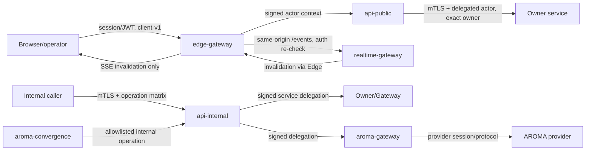
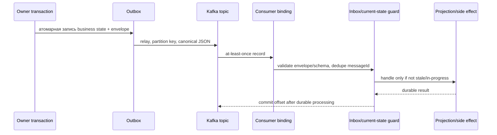

# 05_HTTP и события

[Проекты/CoffeeOrderPlatform/Архитектура/00_Атлас архитектуры](README.md)

## 1. Как читать этот документ

Здесь разделены четыре уровня доказательности:

* **Нормативный контракт** — физический OpenAPI/JSON Schema/config или утверждённый launch/ADR-документ. Это разрешённая форма API/event, но не доказательство работающего сервера.
* **Зарегистрированный handler** — в `apps/**/src` есть вызов `app.get/post/...` или композиционный wiring, который регистрирует обработчик. Это не утверждение, что маршрут live/deployed или прошёл end-to-end gate.
* **Contract-only** — маршрут/event описан, но в проверенном source snapshot нет специфического handler/binding.
* **Stub/fail-closed** — присутствует защитный unavailable/fail-closed helper; он не считается функциональной реализацией.

На 2026-09-22 при `HEAD=4b2cad1dab30af66ad0b2fe64da280222e506574` физический launch OpenAPI содержит **11 client-v1 операций (включая `/events`) и 8 internal-v1 операций**, всего **19 HTTP/SSE операций**, плюс **7 versioned Kafka messages**. Это именно инвентарь контрактов репозитория; live/deployed состояние не заявляется.

## 2. Trust surfaces и ownership

| Surface | Нормативный вход | Auth/trust | Канонический owner/caller | Побочный эффект | Реальное состояние в snapshot |
|---|---|---|---|---|---|
| `client-v1` | `edge-gateway -> api-public -> owner` | Edge проверяет user/session и передаёт короткий signed actor context; `api-public` проверяет issuer/audience/operation и делегирует owner | Bounded-context owner: Customer, Catalog, Pricing, Orders | Read или owner command; unsafe command — idempotency + expected version | Только Customer public handlers зарегистрированы в `api-public`; остальные contract-only |
| `internal-v1` | Caller -> `api-internal` -> exact owner/Gateway | mTLS/SAN + signed delegation, explicit audience/original caller/operation | `api-internal` — trust/delegation boundary, не business writer; owner/Gateway пишет состояние | Private reads, quote verification, catalog/provider operations, AROMA mutation | AROMA и Customer handlers зарегистрированы; Catalog/Pricing internal handlers не найдены |
| `/events` | `edge -> private realtime-gateway origin` | session/JWT; только server-derived permission `orders:read:any`; browser filters запрещены | Realtime gateway владеет bounded fanout/replay, owner владеет business state | Только invalidation metadata; браузер делает GET owner resource | OpenAPI/spec/schema есть, SSE handler и EventSource source не найдены |
| provider | `aroma-gateway -> allowlisted AROMA origin` | gateway-only provider session; browser/edge/Hermes доступа нет | AROMA Gateway владеет provider protocol/session/journal; Orders владеет desired/observed/convergence | Unsafe mutation, fencing, unknown outcome | Gateway HTTP handlers зарегистрированы; provider deployment не доказывается |
| `agent-v1` | Hermes/plugin private surface | service identity + trusted conversation context | Agent/Channel platform boundary | Будущие allowlisted tools; LLM не получает identity/credentials | Первый launch disabled; в текущих launch OpenAPI отсутствует |

`ADR-0019` явно фиксирует `client-v1: edge -> api-public -> owner`, `internal-v1: caller -> api-internal -> owner/Gateway`, `agent-v1` disabled и `/events` только через edge. M19 также говорит, что public edge допускает только `client-v1`; наличие canonical M19 closure с 49 client, 6 agent и 7 internal операциями нельзя смешивать с этим уменьшенным launch contract: launch YAML — отдельный физический набор первого запуска.

## 3. Нормативный HTTP/SSE каталог

Следующая таблица следует физическим OpenAPI: paths и operationIds — не из runtime discovery.

| Surface | Verb + path | operationId | Owner / caller | Auth | Idempotency/version/deadline | Success / error |
|---|---|---|---|---|---|---|
| client | `POST /api/client-v1/customers` | `createCustomer` | Customer / browser через public | bearer actor | `Idempotency-Key`, replay-only; owner default deadline | `201`; RFC 9457 `400/401/403/409/410/500/503` |
| client | `GET /api/client-v1/customers?query=&limit=&cursor=` | `searchCustomers` | Customer / browser | bearer actor | read, cursor-signed; no idempotency | `200`; `400/401/403/500` |
| client | `GET /api/client-v1/catalog/products?...` | `searchCatalogProducts` | Catalog / browser | bearer actor | read, cursor/snapshot | `200`; `400/401/403/503` |
| client | `POST /api/client-v1/pricing/quotes` | `createPricingQuote` | Pricing / browser | bearer actor | idempotency + replay-only; quote expiry/hash | `201`; `400/401/403/404/409/410/500/503` |
| client | `POST /api/client-v1/orders/drafts` | `createOrderDraft` | Orders / browser | bearer actor | idempotency + replay-only | `201`; `400/401/403/404/409/410/500/503` |
| client | `PUT /api/client-v1/orders/{orderRef}/items/{itemRef}` | `upsertOrderItem` | Orders / browser | bearer actor | idempotency + expected owner version in body; replay-only | `200`; `400/401/403/404/409/410/500/503` |
| client | `DELETE /api/client-v1/orders/{orderRef}/items/{itemRef}` | `removeOrderItem` | Orders / browser | bearer actor | idempotency + `If-Match-Version`; replay-only | `200`; `400/401/403/404/409/410/500/503` |
| client | `POST /api/client-v1/orders/{orderRef}/commands/confirm` | `confirmOrder` | Orders / browser | bearer actor | idempotency + expected version; quote proof is server-validated | `200`; `400/401/403/404/409/410/422/500/503` |
| client | `POST /api/client-v1/orders/{orderRef}/commands/request-aroma-reconciliation` | `requestAromaReconciliation` | Orders / browser | bearer actor | idempotency + expected version; unknown outcome is not blind retry | `202`; `400/401/403/404/409/410/500/503` |
| client | `GET /api/client-v1/orders/{orderRef}` | `getOrderCard` | Orders / browser | bearer actor | read; monotonic `projectionVersion` | `200`; `401/403/404/500` |
| client/realtime | `GET /events` | `streamOrderInvalidations` | Realtime / browser through edge | bearer/session; permission `orders:read:any` | `Last-Event-ID`; no command body/filter | `200 text/event-stream`; pre-header `401/403/503` |
| internal | `GET /api/internal-v1/customers/{customerRef}/order-input` | `getCustomerOrderInput` | Customer / orders-service | service mTLS + delegation | read; default 1s owner deadline | `200`; `400/401/403/404/500` |
| internal | `GET /api/internal-v1/catalog/products/{productRef}/variants/{variantRef}/pricing-input` | `getCatalogPricingInput` | Catalog / pricing-service | service mTLS + audience | read; default deadline | `200`; `400/401/403/404/503` |
| internal | `POST /api/internal-v1/pricing/quotes:verify` | `verifyPricingQuote` | Pricing / orders-service | service mTLS + audience | quoteRef/hash + expected facts; no browser idempotency | `200`; `400/401/403/404/409/503` |
| internal | `POST /api/internal-v1/aroma/catalog-exports` | `exportAromaCatalog` | AROMA Gateway / catalog-supplier-sync | service mTLS; NDJSON response | bounded read deadline, snapshot/export refs | `200 application/x-ndjson`; `400/401/403/503` |
| internal | `POST /api/internal-v1/aroma/offer-bindings` | `registerAromaOfferBinding` | AROMA Gateway / catalog-activation-worker | service mTLS + exact operation | idempotent binding policy owned by gateway | `200`; `400/401/403/409/503` |
| internal | `POST /api/internal-v1/aroma/cart-snapshots:read` | `readAromaCartSnapshot` | AROMA Gateway / observer/convergence | service mTLS + exact operation | read, no mutation retry | `200`; `400/401/403/503` |
| internal | `POST /api/internal-v1/aroma/cart-lines/{offerRef}:set-quantity` | `setAromaCartLineQuantity` | AROMA Gateway / aroma-convergence | service mTLS + original caller fence | `operationRef`, positive decimal quantity; no blind transport retry | `200`; `400/401/403/404/409/503` |
| internal | `POST /api/internal-v1/aroma/cart-lines/{offerRef}:remove` | `removeAromaCartLine` | AROMA Gateway / aroma-convergence | service mTLS + original caller fence | `operationRef`; reconcile after unknown outcome | `200`; `400/401/403/404/409/503` |

**Замечание о каталоге.** `docs/launch/12_LAUNCH_CONTRACT_CATALOG.md:244-262` в текстовом списке internal routes не перечисляет `aroma/offer-bindings`, но он есть в `contracts/openapi/internal-v1.yaml`, в `docs/launch/24_SERVICE_IDENTITY_AND_DELEGATION.md:53-58` и реально регистрируется. Поэтому inventory считает его нормативным; это не новый route и не совместимый alias.

**Контракт против реализации quantity.** Таблица перечисляет wire-форму, а не полную поддержку всех её значений. Текущий Gateway отклоняет decimal quantity с точкой до mutation journal/provider call (`apps/aroma-gateway/src/transport/http/index.ts:167-175`). Signed caller capability не равна Orders lease/fence: Gateway проверяет caller/delegation и собственный journal, а business fence принадлежит ещё не материализованной convergence.

### Общая HTTP wire semantics

Все client mutations требуют actor, `Idempotency-Key`, expected owner version там, где это часть command schema, correlation/trace и стабильный Problem Details code. Для потерянного ответа семь command routes используют bodyless `Idempotency-Replay-Only: true` с тем же ключом: owner возвращает сохранённый результат, а permissions/actor проверяются заново. Браузер не присылает provider URL, credential, provider identifier или authoritative money; `confirm` проверяет persisted quote reference/hash и текущий OrderVersion.

`ProblemDetails` — `application/problem+json` с `type/title/status/code/detail/instance/correlationId/errors`; stack trace, SQL, provider response и secrets запрещены. Money и BIGINT/version — decimal strings. `additionalProperties: false` и runtime JSON Schema защищают wire от неописанных полей. Deadlines задаются runtime profiles; в source видны `defaultMs`/`readMs`/`mutationMs`, но отсутствие runtime evidence не превращает это в доказательство SLA.

### Internal delegation и trust checks

`api-public` проверяет actor assertion от edge (`iss=edge-gateway`, `aud=api-public`, operation, TTL), затем подписывает assertion для exact owner с `iss=api-public`, `originalIssuer=edge-gateway`, `aud=owner`, operation/correlation/trace. Owner одновременно требует transport SAN, issuer/audience, allowlisted operation и permission. Для internal caller `api-internal` проверяет mTLS/SAN и выпускает assertion с `originalCaller`; AROMA mutation разрешена только при `originalCaller=aroma-convergence` и exact operation. Совпадение одного path или одного caller capability не даёт.

## 4. Событийный wire contract

### Общий envelope

Физический schema `contracts/schemas/common/message-envelope.v1.schema.json` требует ровно `envelopeVersion`, `messageId`, `messageType`, `occurredAt`, `producer`, `correlationId`, `causationId`, `traceparent`, `aggregate`, `payload`; aggregate — `{type, ref, version}`. Event schemas расширяют envelope с `additionalProperties: false`; версии message type независимы от версии envelope. Kafka runtime дополнительно проверяет traceparent, timestamp, key/offset и canonical JSON перед Inbox/Outbox path.

### Нормативный event catalog

| messageType | kind | Producer | Consumer/group | Topic / key | Payload core | Status |
|---|---|---|---|---|---|---|
| `CatalogSnapshotActivated.v1` | event | catalog-activation-worker | owner/audit fact; consumer group отсутствует | `coffee.catalog.snapshot.v1` / `supplierRef` | supplier/snapshot refs, revisions, counts, activatedAt, SHA-256 contentHash | schema+config contract; message handler не найден |
| `CatalogMappingChanged.v2` | event | catalog-activation-worker | orders-aroma-preparation / `orders-catalog-mapping-v2` | `coffee.catalog.mapping.v2` / `productRef` | product/variant/offer, snapshot+mapping revision, `Active|Missing|Stopped`, availability | schema+config contract; binding не найден |
| `OrderConfirmed.v1` | event | orders-service | orders-aroma-preparation / `orders-aroma-preparation-v1` | `coffee.orders.lifecycle.v1` / `orderRef` | order/customer refs, orderVersion, confirmedAt, contributionRevision | schema+config contract; binding не найден |
| `AromaConvergenceRequested.v1` | command | Orders / preparation | aroma-convergence / `aroma-convergence-v1` | `coffee.aroma.cart.commands.v1` / `cartScopeRef` | scope, desiredRevision, reason, nullable orderRef | schema+config contract; binding не найден |
| `AromaObservationChanged.v1` | event | aroma-observer/convergence | Orders projections / `orders-aroma-projection-v1` | `coffee.aroma.cart.events.v1` / `cartScopeRef` | observedRevision/time, `Complete`, cartFingerprint | schema+config contract; binding не найден |
| `AromaConvergenceChanged.v1` | event | aroma-convergence | Orders projections / `orders-aroma-projection-v1` | `coffee.aroma.cart.events.v1` / `cartScopeRef` | desired/observed revisions, attemptRef, terminal attemptState, blockerCodes | schema+config contract; binding не найден |
| `RealtimeInvalidated.v1` | event | owner services | realtime-gateway / `realtime-gateway-v1` | `coffee.realtime.invalidate.v1` / `subjectRef` | `subjectType=order`, subjectRef, ownerVersion, `OrderChanged|AromaStateChanged` | schema+config contract; SSE consumer binding не найден |

`CatalogMappingChanged.v2` имеет cross-field guard: `Active` требует non-null offerRef, `Missing|Stopped` — null. Convergence payload не переносит business card: projection worker должен сам преобразовать observation/attempt state в Order Card state. Event payloads не содержат credentials, PII, provider cookies, arbitrary URL или полную корзину.

### Kafka transport, retry и replay

`config/platform.yaml:38-86` задаёт SASL_SSL, `autoTopicCreation=false`, partitions 12/24, retention от 1 часа для realtime до 2160 часов для catalog, `<topic>.dlq`, producer retries=3, bounded queues, send/receive/commit/revoke/shutdown timeouts и durable retry `maxAttempts=12`. `docs/launch/06_EVENTS_AND_RECOVERY.md:26-61` добавляет правила: ordering только внутри key; invalid schema один раз quarantine/DLQ с original envelope и sanitized validation result; transport at-least-once, Inbox + current-state guard дают effectively-once business effect; offset commit только после durable processing.

Unsafe AROMA mutation не replay-ится вслепую: после timeout нужен reservation/fence + fresh read/reconciliation; long delay — durable scheduled state, не sleep в consumer. Replay сохраняет original messageId/operation IDs. Большие media/transcript bytes не идут в Kafka; M20 разрешает только ArtifactRef и проверяемую metadata.

### Состояние implementation

Физический `platform-kafka-runtime` реализует generic `KafkaRuntime.bind(groupId, binding)`, parseEnvelope, Inbox/Outbox relay и commit-after-processing. Но `apps/*/src` checked snapshot не содержит messageType-specific producer/consumer binding; worker entrypoints вроде `apps/orders-service/src/main.ts:1-3`, `apps/aroma-convergence/src/main.ts:1-3`, `apps/realtime-gateway/src/main.ts:1-3` только вызывают `startConfiguredRuntime`. Runtime открывает consumer group только если binding зарегистрирован (`packages/platform-kafka-runtime/src/index.ts:1125-1137,1163-1173`). Поэтому нормативные topics/groups — **catalog/config**, а не доказательство обработчиков.

## 5. SSE как отдельный event projection

`RealtimeInvalidated.v1` — Kafka event, `/events` — браузерный transport projection. SSE `resource-invalidated.v1` содержит id=Kafka messageId, subjectType/order ref, ownerVersion, reason и correlationId; `stream-ready.v1`/`stream-reset.v1` — service records без business state; heartbeat — comment каждые 15s. `Last-Event-ID` replay — bounded ring buffer до 10 000 invalidations или 5 минут, reset при malformed/not found/eviction/restart. Браузер после ready/reset/invalidated делает owner GET и не записывает SSE payload в Order cache.

Это не WebSocket, GraphQL subscription, persistent replay DB, per-order client filter или guaranteed browser delivery. Ни `GET /events`, ни realtime consumer не зарегистрированы в проверенных `apps/*/src`; реализация остаётся contract/spec-only.

## 6. Evidence map

### Source table

| Source | Lines / purpose |
|---|---|
| [client-v1 OpenAPI](../../contracts/openapi/client-v1.yaml#L33-L709) | 11 client/SSE operations, schemas, security and responses |
| [internal-v1 OpenAPI](../../contracts/openapi/internal-v1.yaml#L15-L361) | 8 private operations, mTLS and responses |
| [event catalog](../../docs/launch/12_LAUNCH_CONTRACT_CATALOG.md#L288-L323) | seven message types and payload restrictions |
| [Kafka config](../../config/platform.yaml#L38-L86) | topics, partitions, retention, DLQ, delivery budgets |
| [HTTP launch contract](../../docs/launch/03_HTTP_API_CONTRACT.md#L1-L83) | client paths, command/replay/error semantics |
| [event recovery](../../docs/launch/06_EVENTS_AND_RECOVERY.md#L1-L97) | envelope, registry, at-least-once, retry/replay |
| [service delegation](../../docs/launch/24_SERVICE_IDENTITY_AND_DELEGATION.md#L24-L66) | actor/service trust and operation allowlist |
| [public registrations](../../apps/api-public/src/index.ts#L150-L226) | Customer public handlers |
| [internal registrations](../../apps/api-internal/src/index.ts#L185-L292) | Customer + AROMA internal handlers |
| [Kafka runtime binding gate](../../packages/platform-kafka-runtime/src/index.ts#L1125-L1173) | generic binding required before consumer execution |

| Evidence | Что подтверждает | Статус |
|---|---|---|
| `contracts/openapi/client-v1.yaml:33-709` | 11 client/SSE paths, schemas/security/response maps | normative contract |
| `contracts/openapi/internal-v1.yaml:15-361` | 8 private operations, mTLS, response maps | normative contract |
| `contracts/schemas/common/message-envelope.v1.schema.json:18-65` | exact envelope and closed fields | physical JSON Schema |
| `docs/launch/12_LAUNCH_CONTRACT_CATALOG.md:288-323` | seven-message catalog and payload rules | normative catalog |
| `config/platform.yaml:38-86` | topics, partitions, retention, DLQ and delivery budgets | config authority |
| `apps/api-public/src/index.ts:150-226` | two public Customer registrations | registered handlers |
| `apps/api-internal/src/index.ts:185-294` | Customer + AROMA internal registrations; две mutation operations имеют отдельные routes; общий parameterized handler расположен в Gateway | registered handlers |
| `apps/customer-service/src/http/index.ts:289-378` | owner-side Customer public/internal handlers | owner implementation |
| `apps/aroma-gateway/src/transport/http/index.ts:78-241` | AROMA Gateway binding/read/mutation/export handlers | gateway implementation |
| `packages/platform-kafka-runtime/src/index.ts:1125-1173` | generic bind gate before consumer run | runtime capability, not business binding |
| `apps/web/src/main.ts:1-3` | only web runtime bootstrap | no React implementation evidence |

Полный machine-readable inventory и хэши источников находятся рядом: `contract-inventory.json` и `source-manifest.json`. Они не являются новой authority и не меняют repo.

Машиночитаемые каталоги и общий manifest источников: [11_Источники и проверка](11_%D0%98%D1%81%D1%82%D0%BE%D1%87%D0%BD%D0%B8%D0%BA%D0%B8%20%D0%B8%20%D0%BF%D1%80%D0%BE%D0%B2%D0%B5%D1%80%D0%BA%D0%B0.md).
