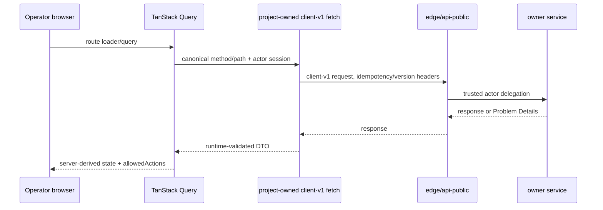
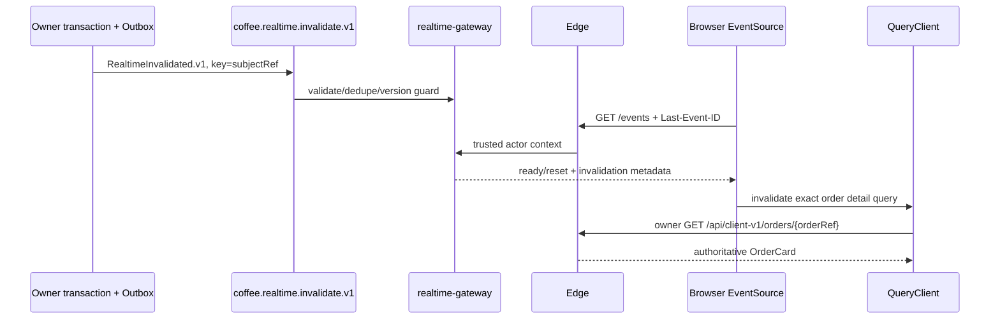

# 06_Frontend и каналы

[Проекты/CoffeeOrderPlatform/Архитектура/00_Атлас архитектуры](README.md)

## 1. Итог в одном абзаце

Нормативный frontend — новая React SPA поверх `client-v1`, с React Router, одним TanStack Query `QueryClient`, project-owned browser fetch client на generated transport types, runtime response validation и одним EventSource на tab. Фактический snapshot содержит не эту SPA, а только `apps/web/src/main.ts` с `startConfiguredRuntime("web")` и package dependency на `@coffee-platform/runtime`. Поэтому ниже отдельно показаны **contract/spec**, **зарегистрированный/физический source** и **не реализовано в проверенном snapshot**. Наличие `dist/main.js`, generated types или UX SVG/mockup не является browser rendering, accessibility PASS, route live/deployed или frontend implementation.

## 2. Ownership и client/server boundary

| Область | Нормативный владелец | Что должен делать | Что фактически найдено |
|---|---|---|---|
| Presentation package | #137, `packages/platform-ui`, `@coffee-platform/ui` | React Aria behavior, Tailwind v4, tokens, IBM Plex Sans, inline SVG | package/source в проверенном `apps/web` не materialized; UX/ADR только spec |
| Browser app | #9 | Router, one QueryClient, project-owned `client-v1` fetch/validation, forms, recovery, static serving | `apps/web` содержит bootstrap-only runtime |
| Realtime | #12 | one EventSource/tab, schema validate, invalidate/refetch, session lifecycle | spec есть; `apps/web/src/realtime/...` не найден |
| Release/accessibility | #13 | Playwright, keyboard/screen reader, CSP, deep links, bundle budgets | evidence/pass не найден; не заявляется |
| Server truth | owner services | identity, money, versions, business state, `allowedActions`, Problem Details | contract/schema/spec only for non-Customer owner paths |

`ADR-0027` запрещает business imports в neutral UI package: generated DTO, fetch, Router, Query, server/runtime, SQL/Kafka/provider code должны оставаться снаружи. Browser graph не импортирует Node `main.ts`/platform runtime; Node graph не импортирует browser entrypoint. В будущей реализации direct dependencies принадлежат #137 (`react`, `react-dom`, React Aria, Tailwind, Vite и styling utilities), а #9 — `react-router-dom`, `@tanstack/react-query` и project-owned client-v1 transport/runtime validation. Generated SDK/client, Axios, Zod, второй QueryClient/transport path и client-side business calculation запрещены.

## 3. Нормативные SPA routes и data flow

| SPA route | Назначение | Server calls | UI source status |
|---|---|---|---|
| `/app/customers` | поиск/создание Customer | `GET/POST /api/client-v1/customers` | implementation spec; no React route source |
| `/app/catalog` | поиск persisted catalog | `GET /api/client-v1/catalog/products` | implementation spec; no React route source |
| `/app/orders/new` | создать Draft, выбрать customer/catalog, quote | `POST /orders/drafts`, catalog GET, pricing POST | implementation spec; no React route source |
| `/app/orders/:orderRef` | Order Card, item PUT/DELETE, confirm, reconciliation | Order GET + command routes | implementation spec; no React route source |
| `/` | redirect/entry в Customer flow | static shell behavior | spec only |

Сценарий намеренно server-led: выбрать/создать customer → явно создать Draft → persisted Catalog → PricingQuote → item mutation → confirm → остаться на Order Card → SSE invalidation/refetch. Browser не считает authoritative total, не выбирает actor identity, не формирует `allowedActions`, не обращается к AROMA, не использует provider URL/session/offer ID и не делает automatic mutation retry.

Команды несут expected owner version; Order `version` — только guard команд, а Order Card `projectionVersion` — только monotonic acceptance для GET/command/replay/SSE refetch. Их нельзя сравнивать. При conflict сохраняются введённые значения и предлагается явный refresh; поздний GET/replay не откатывает более новую projection. `UnknownOutcome` не превращается в кнопку blind retry.



## 4. Server state, actions и ошибки

Сервер владеет `OrderCard`, фактами Customer/Catalog/Pricing, деньгами, версиями, lifecycle и `allowedActions`. Frontend отображает только разрешённые действия, включая `add-item`, `edit-items`, `confirm`, `request-aroma-reconciliation`. Неизвестное значение — нарушение контракта, а не новая кнопка. Один status не разрешает действие. `Blocked` требует причины владельца; `UnknownOutcome` не допускает blind retry; недоступность provider не отменяет durable Order.

Обязательные состояния: initial/loading/empty/validation, отображённый RFC 9457 Problem Details, устаревший quote, optimistic conflict, Draft/Confirmed, AROMA `NotRequested|PendingObservation|OutOfSync|Converging|InSync|Blocked|UnknownOutcome`, неопределённый исход Customer/Draft/Quote и pending intent после reload. Формы используют local React state; server validation связывает `errors[].pointer` с полями. Деньги отображаются из authoritative decimal-string minor units с bigint-safe helper; `Intl.NumberFormat('ru-RU', ...)` применяется только в presentation.

Протокол recovery: после потери ответа команда восстанавливается с тем же idempotency key через bodyless replay-only request. Logout/session switch отменяет reads, очищает query/mutation caches, формы и sessionStorage; поздние ответы старой session отбрасываются. Ответ 401 скрывает защищённые данные; повторная аутентификация не исполняет pending intent автоматически. Optimistic business update, offline mutation и автоматический unsafe provider retry запрещены.

## 5. Realtime/SSE boundary

Нормативный путь — same-origin `GET /events` только через Edge; browser `Authorization` и actor headers запрещены. По спецификации Edge проверяет session и передаёт trusted actor context; первый запуск допускает `orders:read:any` без client subject/order filters. Истечение авторизации закрывает stream; reconnect вновь проверяет auth через Edge. Это целевой протокол, не доказанная реализация текущего bootstrap-only Edge.

Wire frames:

* `resource-invalidated.v1`: `id` = Kafka `messageId`, `subjectType=order`, `subjectRef`, decimal-string `ownerVersion`, `reason=OrderChanged|AromaStateChanged`, `correlationId`; no Customer, items, money, desired/observed quantities, blockers or actions.
* `stream-ready.v1`: connectionId/connectedAt, no id; after replay/reset and live installation.
* `stream-reset.v1`: `{reason:"REPLAY_UNAVAILABLE"}`, no id.
* heartbeat: SSE comment each 15 seconds; server `retry:3000` drives native reconnect.

Алгоритм клиента: validate frame → принять только корректные order ref/version → не писать SSE payload в Order cache → инвалидировать точный active query `['orders','detail', subjectRef]` → owner GET → monotonic `projectionVersion` guard. При ready повторно читаются существующие active Order detail queries, закрывая гонку initial GET/stream. При reset инвалидируется только существующий Order detail prefix; Customer/Catalog/Pricing не затрагиваются. EventSource закрывается при logout/session switch. Метка соединения (`Подключено|Переподключение|Обновление состояния`) не является бизнес-истиной.

Ring replay ограничен 10 000 invalidations или 5 минутами — до первого превышения. Невалидный, неизвестный, вытесненный или потерянный при restart Last-Event-ID приводит к reset и безопасному owner refetch. Это оптимизация, не гарантия доставки; sticky session и persistent replay DB не требуются. Медленный клиент отключается, не блокируя Kafka и здоровые соединения.



Фактическое состояние: `contracts/openapi/client-v1.yaml`, `realtime-invalidated.v1.schema.json`, launch SSE spec и `packages/contracts/realtime-v1` существуют. Но `apps/web/src/main.ts` не создаёт EventSource, `packages/contracts/realtime-v1/src/index.ts` только re-exports generated types/metadata, а `realtime-gateway/src/main.ts` — bootstrap-only. Поэтому не утверждается SSE implementation или stream handler.

## 6. UX spec/mockup против apps/web

`docs/frontend/ux/README.md` — editable UX contract: operational/restrained console, IBM Plex Sans, React Aria semantics, Tailwind v4 tokens, 4px spacing, 36/40/44px controls, focus/error/dialog/keyboard/reduced-motion rules и ровно три responsive диапазона `375–767`, `768–1279`, `>=1280`. Это specification/mockup-level evidence, не rendered browser evidence. ADR-0027 закрепляет future `@coffee-platform/ui` boundary, но его принятие не materializes package.

`apps/web` фактически содержит:

| Physical item | Evidence | Status |
|---|---|---|
| `apps/web/src/main.ts` | `startConfiguredRuntime("web")` | runtime bootstrap only |
| `apps/web/package.json` | единственная dependency `@coffee-platform/runtime`, script `node dist/main.js` | no React/Router/Query dependency |
| `apps/web/dist/*` | generated/build artifacts | не доказывает source UI или browser behavior |
| `apps/web/src/realtime/*` | отсутствует в snapshot | spec-only path |
| React pages, forms, client.ts, EventSource, Playwright/axe evidence | не найдены | not implemented/evidenced |

## 7. VK/Hermes channel boundary и future integration

Первый запуск исключает Hermes/VK business commands. `agent-v1` отключён и не получает listener/route/secret; launch `client-v1` и `internal-v1` не являются Hermes transport. M19 canonical authority описывает отдельную `/api/agent-v1` surface, но launch contract не содержит её machine-readable routes. Нельзя подменять отсутствие `api-agent` stub-ом или проксировать browser/internal API в канал. Hermes/VK также не входят в обязательный цикл второй волны (`docs/wave-2/README.md:106-108`): это более широкий будущий контур.

Будущая Channel Platform boundary: provider callback/ingress валидирует VK event до durable intake, ведёт transport identity ledger и отдаёт opaque `channelIdentityRef`, `conversationRef`, `identityEpoch`; raw provider IDs downstream не передаются. Channel Identity Broker не читает Customer profile и не позволяет LLM выбрать customer ID. Нормативный будущий пример — private `POST /api/internal-v1/channel-identities/attest`, audience только `channel-ingress`, с opaque refs и hashed provider identity. Hermes/Agent Platform владеет turn routing/journal и trusted binding; Customer остаётся владельцем Customer linkage, Catalog/Pricing/Orders не переходят во владение канала.

```mermaid
flowchart LR
  VK[VK provider callback] --> CI[Channel ingress: verify provider]
  CI --> B[Channel Identity Broker]
  B -->|opaque channelIdentityRef + conversationRef + epoch| H[Hermes trusted context]
  H -->|allowlisted agent-v1/tool, no raw IDs| AP[CoffeeOrder plugin / Agent Platform]
  AP -->|resolve_current_customer(), server-derived ref| CS[Customer owner]
  AP -->|read/command only through allowlisted owner APIs| OS[Catalog / Pricing / Orders]
  LLM[LLM/user text] -. cannot choose identity/credentials .-> H
  E[Browser client-v1] -. isolated from channel surface .-> OS
```

Не входит в текущую реализацию: VK callback handler, channel identity route, agent-v1 operations, Hermes Kafka media/transcription workers, outbound provider delivery, model routing, conversation journal и production channel evidence. M20 допускает Kafka media pipeline только через bounded ArtifactRef/metadata; media bytes не должны попадать в Kafka. Любая будущая интеграция должна пройти отдельную route/event/identity authority и не расширять browser trust surface.

## 8. Таблица готовности и незавершённости

### Source table

| Source | Lines / purpose |
|---|---|
| [frontend contract](../../docs/launch/07_FRONTEND_CONTRACT.md#L1-L119) | ownership, routes, server truth and UI states |
| [frontend implementation spec](../../docs/launch/18_FRONTEND_IMPLEMENTATION_SPEC.md#L1-L331) | commands, allowedActions, focus, responsive and tests |
| [SSE implementation spec](../../docs/launch/20_REALTIME_SSE_IMPLEMENTATION_SPEC.md#L1-L196) | auth, wire, replay, fanout and Query invalidation |
| [UX contract](../../docs/frontend/ux/README.md#L1-L228) | visual states, primitives, responsive/accessibility rules |
| [ADR-0027](../../docs/adr/ADR-0027-frontend-ui-foundation.md#L1-L188) | future `@coffee-platform/ui` boundary |
| [web entrypoint](../../apps/web/src/main.ts#L1-L3) | actual bootstrap-only web source |
| [web package](../../apps/web/package.json#L1-L1) | actual dependency boundary |
| [realtime package](../../packages/contracts/realtime-v1/src/index.ts#L1-L10) | generated type re-export, no EventSource |
| [agent/channel topology](../../docs/adr/ADR-0019-greenfield-node26-and-service-topology.md#L89-L107) | agent-v1 disabled, `/events` via edge |
| [channel identity contract](../../docs/CoffeeOrderSystem_CANONICAL_Architecture_EndToEndHardened_RU_2026-08-19/M09_HERMES_VK/08_CHANNEL_IDENTITY_BROKER_CONTRACT.md#L1-L56) | future private attestation boundary |

| Capability | Contract/spec | Physical source | Status |
|---|---:|---:|---|
| client-v1 OpenAPI/types | да | generated types + contract helpers | partial; public owner only for Customer |
| React shell/pages | да | нет | not implemented |
| TanStack Query one-client | да | нет | not implemented |
| project-owned fetch + runtime validation | да | validator helpers only | browser client not implemented |
| `allowedActions` rendering | да | no UI | contract/spec-only |
| `/events` OpenAPI/SSE wire | да | no route/EventSource | contract/spec-only |
| Kafka RealtimeInvalidated schema/topic | да | generic Kafka runtime only | business binding not evidenced |
| UX primitives/design system | да | no `packages/platform-ui` source found | spec/ADR only |
| VK/Hermes/agent-v1 | canonical future docs | disabled/no listener | out of launch |
| browser/accessibility/CSP/deep-link gates | specified | no evidence | not passed |

Ключевой вывод: contract layer достаточно подробен, но frontend и realtime должны считаться **planned/contract-only**, пока не появятся browser source, route composition, generated transport client boundary, EventSource lifecycle и observed tests. Аналогично channel docs задают trust boundary, но не доказывают callback/agent runtime.

Полные физические записи и evidence вынесены в `contract-inventory.json`; хэши и line counts — в `source-manifest.json`.


Машиночитаемые каталоги и общий manifest источников: [11_Источники и проверка](11_%D0%98%D1%81%D1%82%D0%BE%D1%87%D0%BD%D0%B8%D0%BA%D0%B8%20%D0%B8%20%D0%BF%D1%80%D0%BE%D0%B2%D0%B5%D1%80%D0%BA%D0%B0.md).
