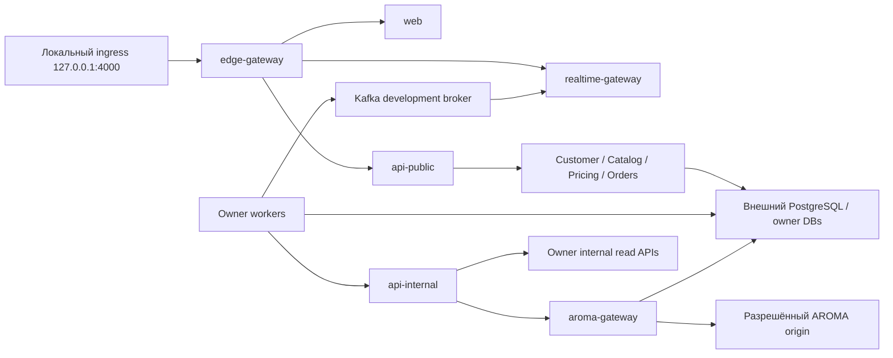

# Инфраструктура, конфигурация и безопасность

[Карта атласа](README.md) · [Владельцы](01_%D0%93%D1%80%D0%B0%D0%BD%D0%B8%D1%86%D1%8B%20%D0%B8%20runtime.md) · [Базы данных](03_%D0%94%D0%B0%D0%BD%D0%BD%D1%8B%D0%B5%20%D0%B8%20%D0%B2%D0%BB%D0%B0%D0%B4%D0%B5%D0%BD%D0%B8%D0%B5.md) · [Проверки](10_%D0%9D%D0%B0%D0%B4%D1%91%D0%B6%D0%BD%D0%BE%D1%81%D1%82%D1%8C%20%D0%B8%20%D0%BF%D1%80%D0%B8%D1%91%D0%BC%D0%BA%D0%B0.md)

> Это архитектурный срез рабочего дерева на 22 сентября 2026 года, не описание проверенного deployment. Значения ниже прочитаны из файлов; контейнеры, БД, AROMA и секреты в рамках этого среза не запускались и не проверялись.

## 1. Что является конфигурационной authority

`config/platform.yaml` — единственный нормативный документ несекретных runtime-настроек. `config/toolchain-versions.json` владеет exact pins. JSON-каталоги runtime, DB ownership, roles, service interactions, permissions и connectivity описывают проверяемые ограничения, но не являются разрешением вводить альтернативные service-config или `.env`. Секретный документ имеет отдельную encrypted SOPS authority; его содержимое здесь намеренно не читается и не копируется. Источники: `AGENTS.md`; `config/platform.yaml:1-4`; `docs/launch/11_CONFIGURATION_AND_SECRETS.md`.

В YAML данного среза `environment: development`. Это важно: значение `https://localhost`, единичный Kafka broker и локальная публикация Edge не являются production topology. Изменение pin-файла, миграции, deployment или включение мутации — отдельные операции с собственными разрешениями. Наличие этой главы не разрешает их.

`config-bootstrap` — init-only trusted role, не шестнадцатый постоянно работающий application runtime. Его реализация `tools/config-bootstrap/index.mjs:80-107` загружает конфигурацию, расшифровывает SOPS в памяти, выбирает `secretRefs` и присутствующие `optionalSecretRefs` конкретного runtime и записывает scoped YAML с mode `0400`. Функция проверки описывает роль как `listener: false`, `longRunning: false` (`:125-128`). Полная расшифровка не передаётся каждому сервису.

Материализация должна попадать в tmpfs. Сам параметр `outputDir` и chmod не доказывают тип файловой системы: это отдельная гарантия bootstrap/Compose-пути. В `compose.yaml:16-21,488-518` `/run/secrets` указан как tmpfs, а sources берутся из scoped файлов, по умолчанию из `/dev/shm/coffee-platform-secrets`. В этой задаче фактический mount, права и отсутствие утечек не проверялись.

## 2. Физическая Compose-топология

В `compose.yaml` находятся Kafka и 15 application services. PostgreSQL service здесь **не создаётся**: БД достигаются через external network `coffee_postgres_data` и host из единого YAML. Из этого не следует, что сервер доступен или что миграции применены. Источники: `compose.yaml:34-487,520-547`; `config/platform.yaml:30-36`.

Это объединённая схема физических связей: не каждый owner или worker обладает каждой стрелкой. Точная индивидуальная allowlist приведена ниже и в `config/platform.yaml`, `platform/launch-v1-connectivity-policy.json`. Стрелки обозначают разрешённые/собранные пути, а не подтверждённые бизнес-вызовы.

| Сеть | Назначение и существенное ограничение |
|---|---|
| `coffee_host_ingress` | `internal: false`, Edge принимает локальный опубликованный порт |
| `coffee_public_ingress` | `internal: true`, Edge ↔ web |
| `coffee_edge_backend` | `internal: true`, Edge ↔ public API / realtime |
| `coffee_public_api_backend` | `internal: true`, public API ↔ business owners |
| `coffee_internal_api` | `internal: true`, внутренний API, owners и разрешённые workers |
| `coffee_postgres_data` | external network, не владение всеми БД одним сервисом |
| `coffee_kafka_event` | `internal: true`, Kafka и разрешённые producer/consumer runtime |
| `coffee_provider_egress` | `internal: false`, внешний путь AROMA Gateway |

Только Edge публикует host-port, причём `host_ip: 127.0.0.1`; остальные используют `expose`. `internal: true`, `expose` и нахождение в одной сети не заменяют authentication, delegation, Node permissions и DB grants. Сетевые ограничения перечислены в `compose.yaml:97-107,520-544`; trust-проверки — в [05_HTTP и события](05_HTTP%20%D0%B8%20%D1%81%D0%BE%D0%B1%D1%8B%D1%82%D0%B8%D1%8F.md).

## 3. Матрица runtime-бюджетов

Таблица механически извлечена из `config/platform.yaml` раздела `services`, а не из старого текста документации. Deadline и pool измеряются соответственно в миллисекундах и соединениях. `null` сохранён буквально: это не нулевой таймаут, не гарантированная бесконечность всех downstream операций и не повод подставить глобальный default. У каждого runtime в этом срезе `replicas: 1`.

| Runtime | Порт | default deadline, ms | concurrency | DB pool max | Outbound HTTP targets |
|---|---:|---:|---:|---:|---|
| `edge-gateway` | 4000 | 5000 | 500 | — | `web:3000`; `api-public:4050`; `realtime-gateway:4401` |
| `api-public` | 4050 | 4500 | 400 | — | `customer-service:4101`; `catalog-service:4102`; `pricing-service:4103`; `orders-service:4104` |
| `api-internal` | 4051 | null | 300 | — | `customer-service:4101`; `catalog-service:4102`; `pricing-service:4103`; `aroma-gateway:4301` |
| `web` | 3000 | 5000 | 500 | — | — |
| `customer-service` | 4101 | 2000 | 100 | 8 | — |
| `catalog-service` | 4102 | 2000 | 150 | 8 | — |
| `catalog-supplier-sync` | 4201 | 900000 | 1 | 4 | `api-internal:4051` |
| `catalog-activation-worker` | 4202 | 5000 | 1 | 4 | `api-internal:4051` |
| `pricing-service` | 4103 | 5000 | 100 | 8 | `api-internal:4051` |
| `orders-service` | 4104 | 5000 | 150 | 4 | `api-internal:4051` |
| `orders-aroma-preparation` | 4203 | 5000 | 16 | 4 | — |
| `aroma-observer` | 4204 | 15000 | 4 | 4 | `api-internal:4051` |
| `aroma-convergence` | 4205 | 30000 | 4 | 4 | `api-internal:4051` |
| `aroma-gateway` | 4301 | 10000 | 8 | 8 | `aroma.origin.host:443` |
| `realtime-gateway` | 4401 | null | 5000 | — | — |

Для Gateway дополнительно заданы `readMs: 900000`, `cartMs: 10000`, `mutationMs: 10000`: длинный поток каталога не должен наследовать короткий бюджет корзины. Для всех runtime общая health-конфигурация: interval 5000 ms, timeout 1000 ms, startup grace 30000 ms, failure threshold 3, success threshold 1. Порог в конфигурации нельзя автоматически трактовать как проверенную hysteresis-реализацию readiness. Process shutdown budget — 30000 ms, body limit — 1048576 bytes. Источники: `config/platform.yaml:6-19` и runtime sections; привязка per-route profiles — `packages/platform-runtime/src/index.ts:634-679`.

DB budget нужно оценивать на весь fleet с reserve и rollout, а не по отдельному pool. Детальное вычисление и расхождение старой таблицы вынесены в [03_Данные и владение](03_%D0%94%D0%B0%D0%BD%D0%BD%D1%8B%D0%B5%20%D0%B8%20%D0%B2%D0%BB%D0%B0%D0%B4%D0%B5%D0%BD%D0%B8%D0%B5.md). Общий statement timeout не означает known rollback: исход транзакции имеет отдельную модель.

## 4. Образ и цепочка сборки

В `Dockerfile:6-27,38-90` заданы pinned Node image, отдельная сборка librdkafka с SHA-256 source tarball, явная native-сборка Confluent addon и frozen pnpm install с отключёнными lifecycle scripts. В этой главе pin — факт локального реестра, **не утверждение о последней версии upstream**. Полный реестр записан в приложении источников; ключевой технический путь — Node 26, Fastify, TS7, pg, Kafka native client, types-only OpenAPI generation.

Последовательность materialization:

1. Отдельная стадия собирает librdkafka.
2. Стадия manifests сохраняет workspace paths, чтобы исходники сервисов не ломали dependency cache.
3. Builder устанавливает locked dependencies, явно строит addon, выполняет compatibility check и typecheck.
4. `RUNTIME` выбирает пакет для `pnpm --filter ... deploy --prod --legacy /runtime`.
5. Native addon копируется в production dependency и проверяется загрузкой.
6. Final image содержит selected production dependency tree, runtime config и permission launcher; `USER node`.

Источники: `Dockerfile:29-36,63-109,112-139`. Отсутствие build tools в final image — конструктивное намерение и выбранный путь Dockerfile, не новый результат image inspection или SBOM scan. Новая сборка image в этой задаче не выполнялась.

`ENTRYPOINT` запускает `scripts/permission-enforce.mjs`; wrapper через `spawn` стартует дочерний Node с permission flags (`scripts/permission-audit.mjs:117-130,158-186`). Поэтому «15 runtime» — число application identities/сервисов, а не доказательство ровно 15 OS-процессов. У контейнера также есть `init: true`.

Compose defaults задают non-root `node`, read-only root, `no-new-privileges`, drop ALL capabilities и ограниченные tmpfs, graceful stop 30s. При этом в просмотренном `compose.yaml` нет per-service CPU/memory resource limits: архитектурное требование лимитов и фактическая декларация — не одно и то же. Источники: `compose.yaml:3-32`; `Dockerfile:137-139`.

## 5. Слои безопасности

### Transport и identity

Edge использует `public-tls`; внутренние application identities — `mtls` в YAML. Runtime проверяет authorized TLS peer через `verifyTransportPeer`, а не доверяет произвольному HTTP-заголовку (`packages/platform-runtime/src/index.ts:602-616`). Service identity и actor/delegation context различны: authenticated service не получает автоматически права пользователя или оригинального инициатора. См. [05_HTTP и события](05_HTTP%20%D0%B8%20%D1%81%D0%BE%D0%B1%D1%8B%D1%82%D0%B8%D1%8F.md) и `docs/launch/24_SERVICE_IDENTITY_AND_DELEGATION.md`.

### Runtime permissions

На каждый runtime есть `config/permissions/<runtime>.json`. Manifest проверяется на exact keys, совпадение имени, отсутствие дубликатов и полное совпадение network allowlist с connectivity policy. Child process, workers и FFI в приложении deny-by-default; native addons допускаются только перечисленным Kafka runtimes. Wrapper сам запускает приложение до применения его permission boundary; это не разрешение приложению порождать процессы. Источник: `scripts/permission-audit.mjs:8-26,64-109,117-130`.

### Data permissions

Доступ к DB — owner-local roles/grants, не общий SQL и не общие изменяемые модели. API roots и web не получают DB pool. Gateway хранит интеграционные технические факты; Orders сохраняет business Desired/Observed/attempts. Даже общий PostgreSQL server не превращает это в единую shared database. См. [03_Данные и владение](03_%D0%94%D0%B0%D0%BD%D0%BD%D1%8B%D0%B5%20%D0%B8%20%D0%B2%D0%BB%D0%B0%D0%B4%D0%B5%D0%BD%D0%B8%D0%B5.md) и [04_Схема PostgreSQL](04_%D0%A1%D1%85%D0%B5%D0%BC%D0%B0%20PostgreSQL.md).

### Provider boundary

Внешний AROMA origin задаётся только конфигурацией, redirects disabled. Бизнес-владелец convergence и транспортный Gateway — разные полномочия; значение `mutationCapability: true` не означает, что production мутации включены или разрешены пользователем. Особые гарантии fencing, operation journal и UnknownOutcome разобраны в [07_AROMA протокол](07_AROMA%20%D0%BF%D1%80%D0%BE%D1%82%D0%BE%D0%BA%D0%BE%D0%BB.md) и [08_AROMA сходимость](08_AROMA%20%D1%81%D1%85%D0%BE%D0%B4%D0%B8%D0%BC%D0%BE%D1%81%D1%82%D1%8C.md).

### Logs и evidence

Fastify request serializer сохраняет method, route template и correlation/trace context, а не произвольные body и headers (`packages/platform-runtime/src/index.ts:401-419`). Пакет observability также содержит recursive key redaction и correlation helpers (`packages/platform-observability/src/index.ts:15-59,121-220`). Это не доказательство redaction всех пользовательских полей, ошибок провайдера, traces или exported artifacts. Canary leakage gate остаётся отдельной проверкой.

## 6. Что нельзя заключить из текущих файлов

- Из TLS options нельзя заключить, что сертификаты валидны и запущенный ingress безопасен.
- Из health endpoint нельзя заключить, что реализован бизнес-сценарий.
- Из encrypted file path нельзя заключить, что secret rotation и backups выполнены.
- Из image digest нельзя заключить, что image собран, проверен и развёрнут.
- Из Kafka volume нельзя заключить HA: в Compose один broker и RF=1.
- Из отсутствия `.github/workflows` в рабочем дереве нельзя заключить отсутствие внешней CI-системы; но нельзя и объявлять GitHub Actions настроенными. В данном срезе workflow-файлы не обнаружены; remote checks не запрашивались.

## Источники и актуализация

[Манифест исходников](11_%D0%98%D1%81%D1%82%D0%BE%D1%87%D0%BD%D0%B8%D0%BA%D0%B8%20%D0%B8%20%D0%BF%D1%80%D0%BE%D0%B2%D0%B5%D1%80%D0%BA%D0%B0.md) хранит hashes и локаторы. После изменения YAML, Compose, Dockerfile, runtime foundation или trust contracts эта глава требует повторной сверки. Проверять конкретный diff; не обновлять дату без повторного чтения.
