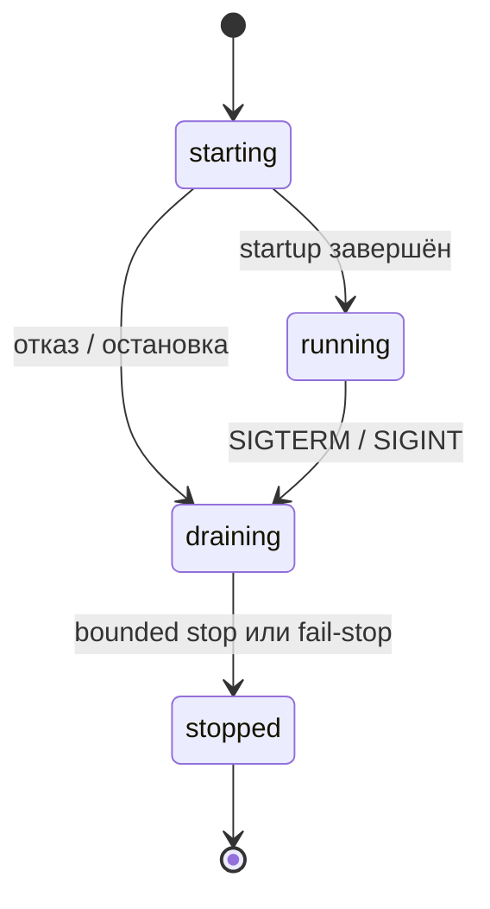

# Надёжность, восстановление и границы приёмки

[Карта атласа](README.md) · [09_Инфраструктура и безопасность](09_%D0%98%D0%BD%D1%84%D1%80%D0%B0%D1%81%D1%82%D1%80%D1%83%D0%BA%D1%82%D1%83%D1%80%D0%B0%20%D0%B8%20%D0%B1%D0%B5%D0%B7%D0%BE%D0%BF%D0%B0%D1%81%D0%BD%D0%BE%D1%81%D1%82%D1%8C.md) · [08_AROMA сходимость](08_AROMA%20%D1%81%D1%85%D0%BE%D0%B4%D0%B8%D0%BC%D0%BE%D1%81%D1%82%D1%8C.md) · [12_Расхождения и незавершённое](12_%D0%A0%D0%B0%D1%81%D1%85%D0%BE%D0%B6%D0%B4%D0%B5%D0%BD%D0%B8%D1%8F%20%D0%B8%20%D0%BD%D0%B5%D0%B7%D0%B0%D0%B2%D0%B5%D1%80%D1%88%D1%91%D0%BD%D0%BD%D0%BE%D0%B5.md)

> Нормативные требования, существующий код, историческое evidence и свежая проверка — четыре разных вида свидетельств. Этот атлас не выдаёт новый launch PASS и не подтверждает production-ready состояние.

## 1. Модель отказов

Система различает транспортную ошибку и бизнес-исход. Отсутствующий HTTP-ответ не означает отсутствие commit или provider effect. Kafka redelivery не означает необходимость повторного бизнес-действия. Cancelled Promise ожидания не доказывает остановку операции. Потерянный COMMIT response не равен ROLLBACK; failed cart GET не равен пустой корзине.

Эти правила проходят через несколько отдельных механизмов:

| Место отказа | Защита | Что не следует делать |
|---|---|---|
| HTTP response после owner commit | Durable idempotency record + read-only recovery lookup | Создавать новый ключ и повторять действие как новое |
| SQL ошибка/таймаут/потеря terminal response | Opaque transaction, known/unknown outcome, bounded pool cleanup | Считать timeout доказанным rollback |
| Duplicate Kafka record | Inbox + owner state + Outbox в одной owner transaction | Повторять handler до проверки Inbox |
| Outbox publish ack, но нет finalize | Lease/fencing, тот же message identity/hash, consumer dedupe | Потерять pending row или выдать exactly-once delivery |
| Provider mutation response loss | Durable operation journal, UnknownOutcome, fresh GET/reconciliation | Blind retry старого operationRef |
| SSE disconnect/drop | Invalidation + refetch authoritative resource | Использовать SSE как durable business ledger |
| Shutdown зависшего ресурса | Bounded drain, reverse stop, destroy, process fail-stop | Обещать принудительную отмену любого Promise |

Источники: `docs/launch/13_DELIVERY_DEPENDENCY_GRAPH.md:53-100`; `docs/launch/21_LAUNCH_VERIFICATION_SPEC.md:228-369`; детали [03_Данные и владение](03_%D0%94%D0%B0%D0%BD%D0%BD%D1%8B%D0%B5%20%D0%B8%20%D0%B2%D0%BB%D0%B0%D0%B4%D0%B5%D0%BD%D0%B8%D0%B5.md), [05_HTTP и события](05_HTTP%20%D0%B8%20%D1%81%D0%BE%D0%B1%D1%8B%D1%82%D0%B8%D1%8F.md), [08_AROMA сходимость](08_AROMA%20%D1%81%D1%85%D0%BE%D0%B4%D0%B8%D0%BC%D0%BE%D1%81%D1%82%D1%8C.md).

## 2. Runtime lifecycle в коде

`packages/platform-runtime/src/index.ts` материализует фазовую модель `starting → running → draining → stopped`. Недопустимые переходы отклоняются; повтор shutdown использует сохранённый promise. Runtime отслеживает pending work, request abort controllers, handlers, sockets и acquired resources. При истечении общего shutdown budget он возвращает `fail-stop`, destroys зарегистрированные ресурсы и не выдаёт зависший Promise за завершившийся. Источники: `:367-380,426-525,783-808`.

Диаграмма показывает допустимый happy-path lifecycle и остановку; ошибки ресурсов сохраняются отдельно. Она не означает, что любой startup callback может быть физически прерван.

Для business request до принятия durable effect client disconnect вызывает AbortSignal. После known durable commit owner может вызвать `acceptDurable`; hook не должен приписывать disconnect отмену принятого эффекта. Request deadline всё равно ограничивает transport, а durable owner result восстанавливается через предусмотренный контракт. Источник: `packages/platform-runtime/src/index.ts:117-118,634-688`.

Readiness требует `phase === running`, listening server, регистрации всех required dependencies и успешных bounded checks. Single-flight bookkeeping не создаёт бесконечную цепь новых проверок поверх зависшего dependency promise. Liveness отвечает за живой процесс, не за бизнес-готовность. Источник: `packages/platform-runtime/src/index.ts:695-767`.

## 3. Наблюдаемость: реализованные точки и будущая эксплуатация

В runtime есть `/health/live`, `/health/ready`, `/metrics`; metrics response содержит `runtime_admission_rejected_total` и строки, предоставленные составленным runtime. Это Prometheus text exposition, не само по себе полный observability backend (`packages/platform-runtime/src/index.ts:768-781`). Есть correlation id и traceparent propagation helpers, структурированные logs и hooks расширения.

Нормативный Operations handoff требует Collector/OpenObserve, exporters, alerts, storage/redaction и `pnpm test:observability`; владелец — #64. В просмотренном root package script `test:observability` отсутствует; Compose не содержит Collector/OpenObserve services. Поэтому наличие OTEL environment variables или `@opentelemetry/api` dependency нельзя называть готовым G14. Источники: `docs/launch/13_DELIVERY_DEPENDENCY_GRAPH.md:90-100,126`; `docs/launch/21_LAUNCH_VERIFICATION_SPEC.md:148-176`; `package.json:12-47`; `compose.yaml`.

Требуемые G14 сигналы включают request duration/count/errors, DB/Kafka pools и lag, Outbox/Inbox backlog, Attempt/UnknownOutcome, SSE connections/drops. Metric labels должны оставаться bounded: payload, body, key, SQL, PII и correlation identifiers не являются labels. Correlation/causation/traceparent — поля logs/traces. Требования к alerts: not-ready 5m, consumer lag 5m, Outbox oldest 5m, UnknownOutcome >0 2m, SSE drop >5% 5m. Это **пороговые требования спецификации**, не измеренный SLO данного среза.

## 4. Launch gate: полный нормативный каталог

Authority — `docs/launch/21_LAUNCH_VERIFICATION_SPEC.md:6-17,59-101`. Все mandatory gates должны иметь evidence одного SHA, exact command, exit 0 и артефакты. Любой FAIL, SKIPPED, NOT_RUN или evidence другого SHA означает `НЕ ДОПУСТИТЬ`. Этот атлас не является выполнением gate runner.

| Gate | Проверяемый результат |
|---|---|
| G00_PREFLIGHT | Чистый SHA, accepted prerequisites, точная forge authority, отсутствие legacy DB target |
| G01_INSTALL | Frozen lockfile install, неизменный lock, контролируемые lifecycle/network эффекты |
| G02_GENERATED | Generated contracts byte-equal исходной генерации |
| G03_STATIC | Format, lint, typecheck, zero warnings |
| G04_UNIT | Domain/unit suites и требуемое critical coverage |
| G05_CONTRACTS | Runtime schema validation fixtures, no unapproved breaking changes |
| G06_ARCHITECTURE | Разрешённые зависимости проходят, запрещённые отклоняются |
| G07_CONFIG_SECURITY | Pins, config, secret scoping/redaction, отсутствие canary leaks |
| G08_MIGRATIONS | Clean/forward migration пяти owner DB и безопасный rerun |
| G09_DB_BOUNDARIES | Нужные grants разрешены, cross-owner SQL запрещён |
| G10_INTEGRATION | Реальные HTTP/DB/Kafka, idempotency, concurrency |
| G11_RECOVERY | Duplicate/crash/replay/rebalance/lease/fence/reservation |
| G12_SUPPLY_CHAIN | SBOM/provenance и security scan |
| G13_COMPOSE | Runtimes ready, dependency failures, graceful shutdown |
| G14_OBSERVABILITY | Metrics, traces, correlation, alerts, redaction |
| G15_BROWSER | Chromium, accessibility, deep-link, conflicts, realtime |
| G16_AROMA_SANDBOX | Контролируемая мутация, lost response, recovery, exact baseline restore |
| G17_BACKUP_RESTORE | Пять restore в новые DB, совпадение schema/data/invariants |
| G18_ROLLBACK | Mutation disabled, observer/recovery живы, durable state сохранено |
| G19_REPORT | Русский детерминированный отчёт, defects и checksums |

Точные команды необходимо брать из versioned matrix/spec и сверять с существующим `package.json`. Часть нормативных команд ещё не materialized. Отсутствующую команду нельзя подменять похожим smoke и отмечать PASS. Самостоятельно запускаемый subset тестов не заменяет это покрытие.

## 5. Особые правила AROMA sandbox

Нормативный G16 требует одновременно scoped sandbox credentials, allowlisted origin/account fingerprint, включение mutation в единственном versioned config и signed approval. Он не запускается обычным PR CI и не разрешает production origin/account. Полный сценарий: initial complete GET и baseline → equality/no-op → один diff и одна reserved mutation → verification GET → injected response loss → restart/fresh GET без replay старого operationRef → явно разрешённое восстановление baseline → final fingerprint equality. Любая ошибка approval, expiry, SHA, allowlist или restore — FAIL и disable. Источник: `docs/launch/21_LAUNCH_VERIFICATION_SPEC.md:103-128`.

Это описание требований, а не permission. В текущем исследовании не делалось даже read-only provider probe. Значения credentials, provider bodies и account-specific реальные данные не включены в атлас.

## 6. Резервное восстановление и rollback — два разных контура

### Бизнес-БД

G17 требует encrypted custom dump каждой owner DB, отдельную новую restore DB, single-transaction restore, schema/constraint/owner invariants и проверку pending Outbox/Inbox/Attempt/Reservation. Completed effects не повторяются; незавершённые продолжаются безопасно; UnknownOutcome начинает с GET. Требование времени: не более 10m для одной БД и 30m суммарно на записанном окружении. Это не измерение текущего RTO. Источник: `docs/launch/21_LAUNCH_VERIFICATION_SPEC.md:130-146`.

### Отключение мутации

G18 описывает committed/versioned `services.aroma-convergence.mutationsEnabled=false`, restart только convergence и продолжение observer/recovery без новых provider mutations. В прочитанном YAML есть `mutationCapability`, но этого недостаточно для утверждения о наличии рабочего `mutationsEnabled` toggle. Capability и operational enable switch — разные вещи. Требуемое поведение ещё надо сверить с реализацией convergence и launch admission. Источники: `docs/launch/21_LAUNCH_VERIFICATION_SPEC.md:178-196`; `config/platform.yaml`, раздел `aroma-convergence`; [08_AROMA сходимость](08_AROMA%20%D1%81%D1%85%D0%BE%D0%B4%D0%B8%D0%BC%D0%BE%D1%81%D1%82%D1%8C.md).

### Память Obsidian

Snapshot vault защищает архитектурные заметки и их связи, но **не** PostgreSQL, Kafka, provider cart или business artifacts. Это независимый локальный ZIP с checksum manifest, не результат G17. Перед записью этого атласа был сделан локальный проверенный snapshot; точное имя архива и проверки нового атласа находятся в [11_Источники и проверка](11_%D0%98%D1%81%D1%82%D0%BE%D1%87%D0%BD%D0%B8%D0%BA%D0%B8%20%D0%B8%20%D0%BF%D1%80%D0%BE%D0%B2%D0%B5%D1%80%D0%BA%D0%B0.md).

## 7. Историческое evidence и текущий срез

`evidence/handoffs/issue-<N>.yaml` передаёт outputs и verification commands предыдущего этапа. Hash source artifact относится к указанному commit; нельзя переписать его под нынешнее дерево или объявить старый report новым test execution. Accepted merge проверяется через Git/GitHub, а не выводится из существования YAML. Источник: `docs/launch/13_DELIVERY_DEPENDENCY_GRAPH.md:136-162`.

При обновлении атласа фиксировать отдельно:

1. Source revision и наличие dirty изменений.
2. Фактические code/DDL/contract declarations.
3. Исторические executed tests с их revision и ограничениями.
4. Свежие команды, exit codes, scope и NOT_RUN.
5. Runtime/owner acceptance, если она действительно состоялась.

В этой задаче свежая проверка относится к достоверности и работоспособности **архитектурной базы знаний**: файлам, источникам, links, Bases и схемам. Полный `pnpm check`, integration/Compose, DB introspection, provider proof, browser E2E, security scan и production deployment не выполнялись. Их отсутствие не скрывается и не заполняется синтетическим evidence.
